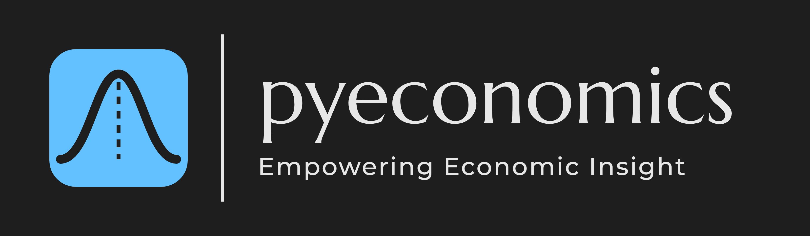

<p align="center">
  
</p>

# pyeconomics

<!-- mcp-name: io.github.pyeconomics-dev/pyeconomics -->

[](https://github.com/pyeconomics-dev/pyeconomics/actions/workflows/ci.yml)
[](https://pypi.org/project/pyeconomics/)
[](https://github.com/pyeconomics-dev/pyeconomics/blob/main/LICENSE)
[](https://scorecard.dev/viewer/?uri=github.com/pyeconomics-dev/pyeconomics)

pyeconomics provides 50 tested, cited economics and finance model
families across 13 domains: foundations, fixed income, derivatives,
international, equity, corporate, accounting, portfolio, performance, risk,
econometrics, macroeconomics and asset pricing. The data platform adds 31
providers, 171 catalog concepts and live bindings with real-time vintages.
Every model is served identically through the Python API, the `pyeconomics`
command line, the REST API (`pyeconomics serve`), the MCP server
(`pyeconomics mcp`), the web app and tabular or reproducibility-bundle exports.
Typed inputs declare units and bounds; every result carries
a reproducible provenance manifest. Rates and percentages are decimals:
`0.05` means 5%.

1.0.0 is the stable release. Its
[public API](https://docs.pyeconomics.dev/en/stable/public-api.html) follows
Semantic Versioning: nothing in it changes incompatibly before 2.0.

## Install

Python 3.12 or later:

```sh
pip install pyeconomics
```

Optional extras add econometrics, plotting, the REST API and the MCP server:
`pip install "pyeconomics[econometrics,plot,server,mcp]"`.

## Use it

- **On the web.** [pyeconomics.dev](https://pyeconomics.dev) has a page and a
  calculator for every model, a data explorer with a page for every catalog
  concept, and search. It serves the data sources whose terms allow it, from a
  snapshot at most a day old.
- **On your own machine.** `pip install "pyeconomics[app]"`, then
  `pyeconomics serve`, runs the same site at <http://127.0.0.1:8000>, with
  every source and the whole data catalog on your own keys.
- **In an AI assistant.** `uvx --from "pyeconomics[mcp]" pyeconomics mcp`
  runs the MCP server on your machine; the hosted server is at
  `https://pyeconomics.dev/mcp`.
- **From Python, the command line or an API.** The
  [documentation](https://docs.pyeconomics.dev/) has tutorials, how-to guides
  and every model's card, and guides to the
  [command line](https://docs.pyeconomics.dev/en/stable/cli.html),
  [REST API](https://docs.pyeconomics.dev/en/stable/api.html),
  [MCP server](https://docs.pyeconomics.dev/en/stable/mcp.html),
  [exports](https://docs.pyeconomics.dev/en/stable/exports.html),
  [AI narrative](https://docs.pyeconomics.dev/en/stable/ai.html),
  [data](https://docs.pyeconomics.dev/en/stable/data/index.html) and
  [keys](https://docs.pyeconomics.dev/en/stable/data/keys.html).

The [release notes](https://github.com/pyeconomics-dev/pyeconomics/blob/main/docs/releases/1.0.0.md)
list what 1.0 contains and its known limitations. The
[project roadmap](https://github.com/pyeconomics-dev/pyeconomics/blob/main/docs/roadmap/ROADMAP.md)
and [architecture decisions](https://github.com/pyeconomics-dev/pyeconomics/tree/main/docs/adr)
record the plan.

## pyeconomics 0.2.x

1.0 replaces the 0.2.x API. 0.2.6 was the last release of the 0.2.x line, four
monetary-policy rules over FRED data, and it reached end of life with 1.0.0 on
2026-11-28: it receives no more fixes.

- The [migration guide](https://docs.pyeconomics.dev/en/stable/migration.html)
  maps each 0.2.x call to 1.0.
- 0.2.x is MIT-licensed. Its source lives on the
  [`legacy/0.2.x`](https://github.com/pyeconomics-dev/pyeconomics/tree/legacy/0.2.x)
  branch, and its documentation at <https://docs.pyeconomics.dev/en/v0.2.6/>.
  Pins such as `pyeconomics<1` keep working on Python 3.11 and 3.12, which
  0.2.6 requires.
- 0.2.0 to 0.2.5 log the FRED API key at DEBUG level. Upgrade to 1.0 or 0.2.6
  and rotate any key those versions used: see advisory
  [GHSA-j6rp-vwwv-jrr8](https://github.com/pyeconomics-dev/pyeconomics/security/advisories/GHSA-j6rp-vwwv-jrr8).

## Not to be confused with

This project is not [`davidrpugh/pyeconomics`](https://github.com/davidrpugh/pyeconomics)
(computational-economics course code from 2013–14) or
[pyecon.org](https://pyecon.org/) (a site teaching Python for economics). The
three share only the name.

## Contributing and security

- [CONTRIBUTING](https://github.com/pyeconomics-dev/pyeconomics/blob/main/CONTRIBUTING.md):
  setup, DCO sign-off, commit conventions and the model definition of done.
- [SECURITY](https://github.com/pyeconomics-dev/pyeconomics/blob/main/SECURITY.md):
  report a vulnerability privately, never in a public issue.
- [Code of Conduct](https://github.com/pyeconomics-dev/pyeconomics/blob/main/CODE_OF_CONDUCT.md).
- [Changelog](https://github.com/pyeconomics-dev/pyeconomics/blob/main/CHANGELOG.md).

## Licence

From 1.0, pyeconomics is licensed under the
[Apache License 2.0](https://github.com/pyeconomics-dev/pyeconomics/blob/main/LICENSE);
see also [NOTICE](https://github.com/pyeconomics-dev/pyeconomics/blob/main/NOTICE).
Releases up to and including 0.2.x remain MIT-licensed.

## Notices

As is; not investment advice. pyeconomics is for educational and informational
use only, and is not registered with any regulator.

<!-- Keep the CFA notice on one line: it is quoted verbatim from ROADMAP §5. -->
CFA® and Chartered Financial Analyst® are registered trademarks owned by CFA Institute. pyeconomics is not affiliated with, endorsed by, or a Prep Provider of CFA Institute.
