# Dogfooding round 0: the site before its design

Round 0 of the protocol in [dogfooding.md](dogfooding.md), run on 2026-11-15 in
Phase 5 Step 17, before any design work. It looked at the site as Steps 3 to 16 left
it: shadcn/ui's stock neutral theme, the system font, every colour a grey but the
link blue and the destructive red.

- **Site:** the local production build (`wrangler dev` on `main` at a6b7433, with
  `tests/web/e2e_api.py` answering the API over the catalog world's stand-in data).
- **Harness:** `npm run dogfood`, run `round-0`: 18 page types at 390x844, 820x1180
  and 1440x900 in light and dark (108 captures), and 30 task states. All 138 passed.
- **Evaluators:** five fresh subagents, one per persona, that had seen nothing of the
  implementation. Claude Code's subagents run Claude models only, so they ran on
  Claude Sonnet 5.5, a different model from the implementer's (Claude Opus 5.5).
  Each did its tasks in Chromium through `tests/dogfood/visit.ts` (15 to 54 browser
  steps each), read every contact sheet, and returned the protocol's JSON.

## Scores

| Dimension | P1 candidate | P2 developer | P3 student | P4 first visit | P5 phone | Median |
| --- | --- | --- | --- | --- | --- | --- |
| D1 First impression and identity | 5 | 5 | 5 | 5 | 6 | **5** |
| D2 Hierarchy and layout | 5 | 5 | 6 | 5 | 5 | **5** |
| D3 Typography and formulas | 6 | 6 | 6 | 6 | 6 | **6** |
| D4 Colour, contrast and theming | 6 | 5 | 5 | 5 | 7 | **5** |
| D5 Interaction, feedback and motion | 6 | 7 | 5 | 7 | 6 | **6** |
| D6 Navigation and findability | 6 | 5 | 5 | 6 | 6 | **6** |
| D7 Content and microcopy | 5 | 6 | 6 | 6 | 6 | **6** |
| D8 Trust and polish | 7 | 6 | 6 | 6 | 6 | **6** |
| Mean | 5.75 | 5.63 | 5.50 | 5.75 | 6.00 | **5.75** |

The round's median, the median of the five means, is **5.75**: "tidy but stock" on
every dimension. Step 18's stopping rule reads its rounds against this baseline.

## Tasks

| Persona | Task 1 | Task 2 | Task 3 | Task 4 | Task 5 |
| --- | --- | --- | --- | --- | --- |
| P1 CFA® Program candidate | hard: symbols undefined, page very long | hard: bond price not on the duration page; result below the fold | pass | pass | |
| P2 Python developer | hard: no code on the home page | pass: snippets after a run | hard: no on-site MCP explanation | hard: manifest unexplained | |
| P3 economics student | hard: no route to data from home; typing lost before the filter loaded | hard: no citation help | hard: calculator ten screens down; notice contradicts the live run | pass | |
| P4 first-time visitor | hard: who it is for and that it is free not said | hard: no "how it is checked" | hard: nothing invites a try | pass | |
| P5 phone visitor | hard: 200-pixel header, calculator far down | pass | pass | pass | hard: formula clipped |

Of 21 tasks, 9 passed, 12 were hard and none failed.

## Findings

Merged across personas; the personas who found each are in brackets. "Fixed" means
fixed in Step 17, checked by the harness on the new design (run `design-3`, where all
138 captures report no overflow, console error or policy violation).

### Blocker

None.

### High

| # | Finding | Destination |
| --- | --- | --- |
| H1 | The home page is a heading, a paragraph, two buttons and an install line: no identity, nothing to try, not who it is for or that it is free, no route to the data [P1 P2 P3 P4 P5] | Fixed: a hero that says what, for whom and that it is free, a live calculator, the paths to models, data and documentation |
| H2 | No "how is this checked" for a first visitor [P4] | Fixed: "How every model is checked" on the home page. The footer's version reads `1.0.0rc1.dev1` because the build is a pre-release; it reads 1.0.0 at the release |
| H3 | A model's calculator sits below six to ten screens of variable tables, repeated per calculation, with no way to jump to it [P1 P2 P3 P4 P5] | Fixed: jump links led by "Run the calculator", each calculation's tables in a disclosure (the first open), an "On this page" list on wide screens |
| H4 | A long formula is clipped at 390, and the page scrolls sideways [P1 P2 P3 P4 P5] | Fixed: formulas scroll in their plate with a shadow at the edge that has more; no sample page scrolls sideways (a new check in `pages.spec.ts`) |
| H5 | The explorer's chart is a white box on the dark theme [P3] | Fixed: charts take the tokens' colours on a transparent background (`plotly.ts themed()`) |
| H6 | A formula's symbols are never defined: no "where" list, and the variable tables name fields, not symbols [P1] | Issue #343: the model cards hold no symbol definitions, so the pages cannot show them until the cards do |
| H7 | Nothing on the site explains the MCP server or shows code before a run [P2] | Fixed: the home page's "The same model from code" (Python, the command line, REST and the MCP command, linking the documentation's MCP page) and the worked example as code on every model page |

### Medium

| # | Finding | Destination |
| --- | --- | --- |
| M1 | The phone header takes 200 pixels; its links are small tap targets [P4 P5] | Fixed: one row (the mark, search, a 44-pixel "Menu") |
| M2 | Grey everywhere; the primary action does not stand out; colour means nothing [P1 P2 P4] | Fixed: the token set (direction.md) |
| M3 | Validator messages ("must have required property 'Fixed Costs'", ".periods must be >= 0"), shown three times [P1 P3 P4 P5] | Fixed: plain words, once beside the field and once in the status line |
| M4 | Results as raw floats (0.10014999999999999) and raw ids; the result stays below the fold [P1 P3 P4 P5] | Fixed: ten significant digits, a decimal's percent beside it, the result scrolled into view. Output names stay the API's field names, with their description beneath; the unit "money" is the models' own (they hold no currency) |
| M5 | The form's error state overflows at 390 [P1 P4 P5] | Fixed |
| M6 | The form's labels and options: "None (null)", option ids such as `act_act_icma`, optional fields not grouped [P1 P3] | "None (null)" is "Leave it out", bounds and decimals are in words; option names and an "Advanced" group stay open for Step 18 |
| M7 | #320: the live-data notice uses jargon and field names, and contradicts a live run that works [P3] | Fixed (#320 closes) |
| M8 | Explorer: the chart is not drawn on load, its axis reads "Units" with decimal ticks, the attribution collides with the axis title [P3] | Overlap and percent ticks fixed; drawing on load stays open for Step 18 |
| M9 | On /data/, typing before the filter loads is lost [P3] | Open for Step 18 |
| M10 | No "cite this series" [P3] | Open for Step 18 |
| M11 | "planned: Phase 7" on the home page [P4] | Fixed: "coming later" |
| M12 | The page shifts as a calculator loads (layout shift up to 0.75) [P5 P2] | Improved: the calculator's card holds its room (worst 0.32; 8 of 108 captures above 0.1, from 20). The rest is open for Step 18 |
| M13 | Code samples hidden in a closed disclosure below a run's result [P2] | Fixed (H7) |
| M14 | The manifest and the reproducibility bundle are not explained [P2] | Fixed: the download note says what the manifest holds and links the documentation |

### Low

| # | Finding | Destination |
| --- | --- | --- |
| L1 | /models/: the filters take the first screen; the cards look alike [P1] | Open for Step 18 |
| L2 | Search: no suggestions while typing; weak results ranked high [P5] | Open for Step 18 |
| L3 | /sources/: "snapshotted" is jargon; no jump list [P3] | Open for Step 18 |
| L4 | /pro/ opens with "Pro does not exist yet" [P4] | By design: the page leads with its disclosure (AGENTS.md, Growth signal rules) |
| L5 | Word subscripts set in italic (D_Mac), loose spacing [P1] | The formulas' text is the model cards' (issue #343); spacing improved with the math font |
| L6 | The header's domain row is small and flat [P1] | Improved: larger, spaced, the current section marked |
| L7 | The domains toggle is small [P5] | Fixed (M1) |
| L8 | A failed copy shows no message [P2] | Open for Step 18 |
| L9 | /models/ cards lack the model id [P2] | Open for Step 18 |
| L10 | Links that leave the site are not marked [P2] | Open for Step 18 |

The harness also found a defect no evaluator named: on a model page at desktop
widths, the header lost its navigation and its domain row as soon as a calculator
loaded, because the calculator's stylesheet repeated utilities that overrode the
page's responsive rules. It is fixed (`src/lib/adopt-styles.ts`) and guarded by a
new check in `navigation.spec.ts`.

## Screenshots

| | |
| --- | --- |
| 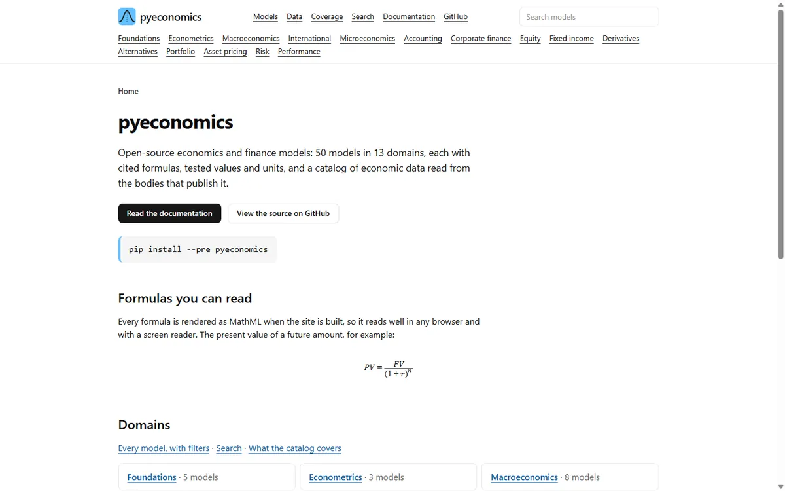 | 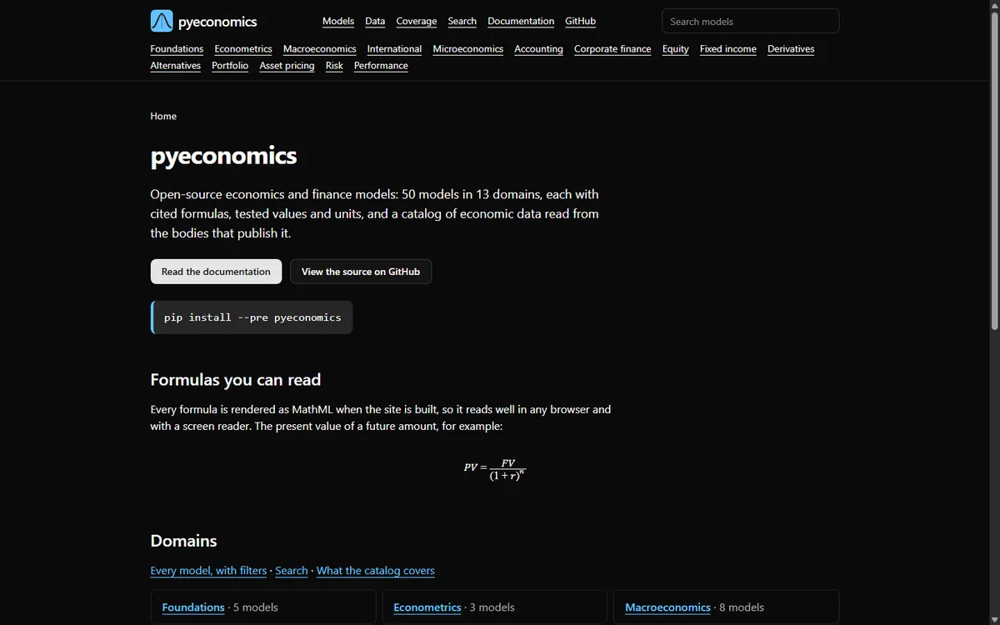 |
| The home page at 1440, light (H1) | The same, dark (M2) |
| 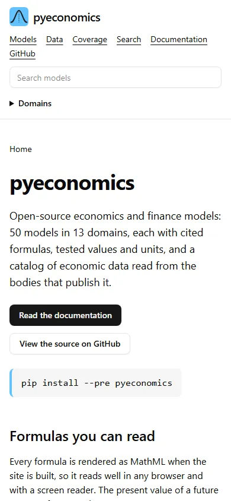 | 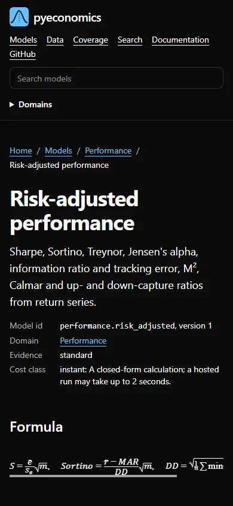 |
| The home page at 390: a 200-pixel header (M1) | A formula clipped at 390 (H4) |
| 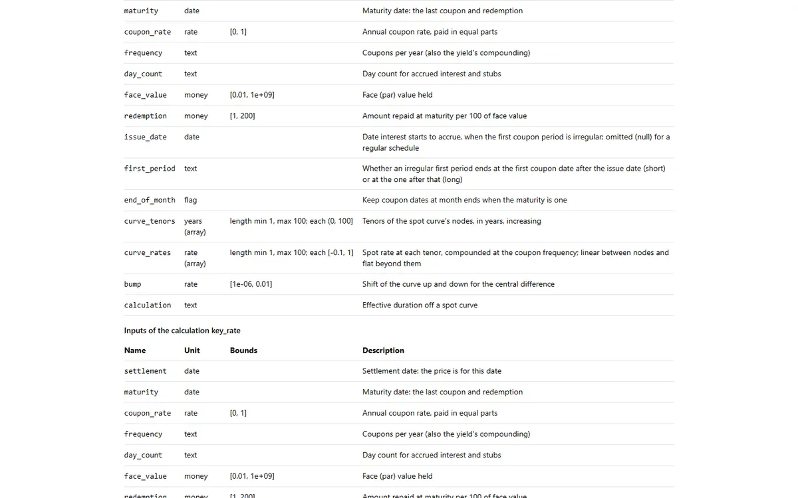 | 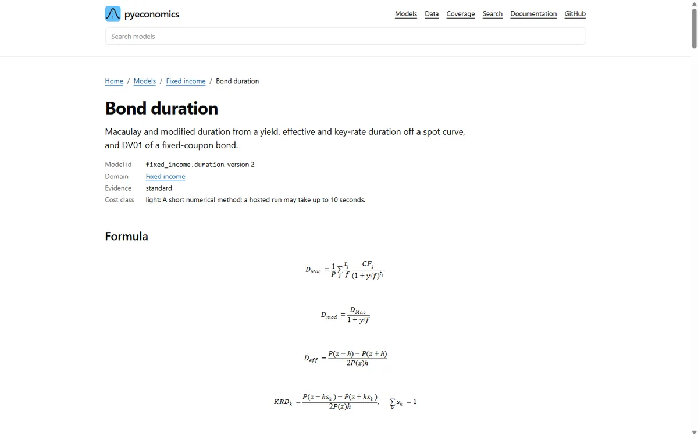 |
| Variable tables before the calculator (H3) | The header after a calculator loads: no domain row |
| 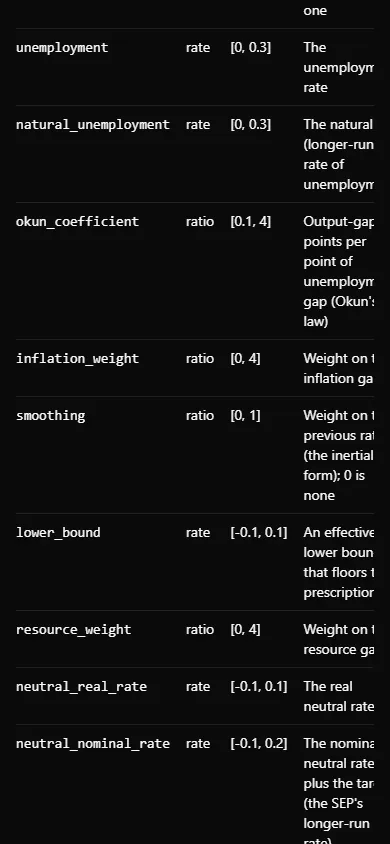 | 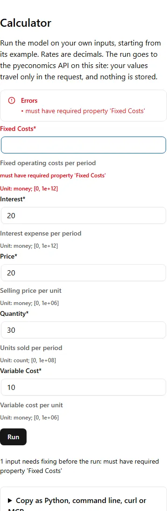 |
| A variable table running off a phone (H4) | The form's error state (M3, M5) |
| 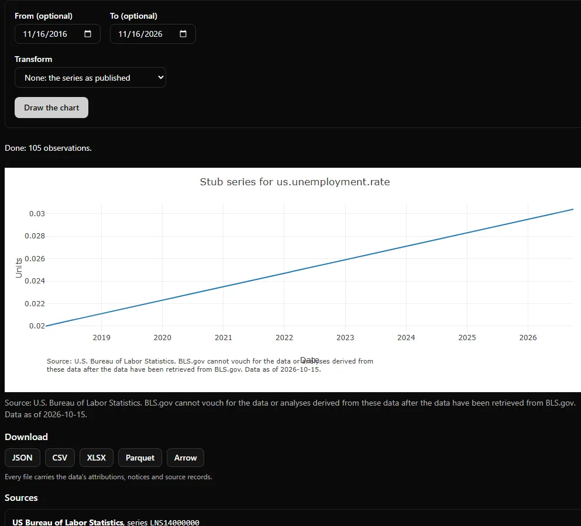 | 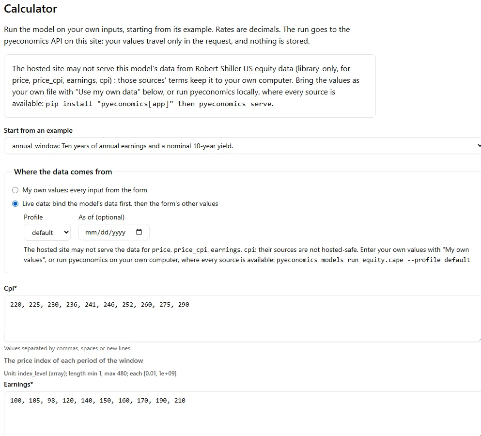 |
| The explorer's chart on the dark theme (H5) | The live-data notice (M7, #320) |
| 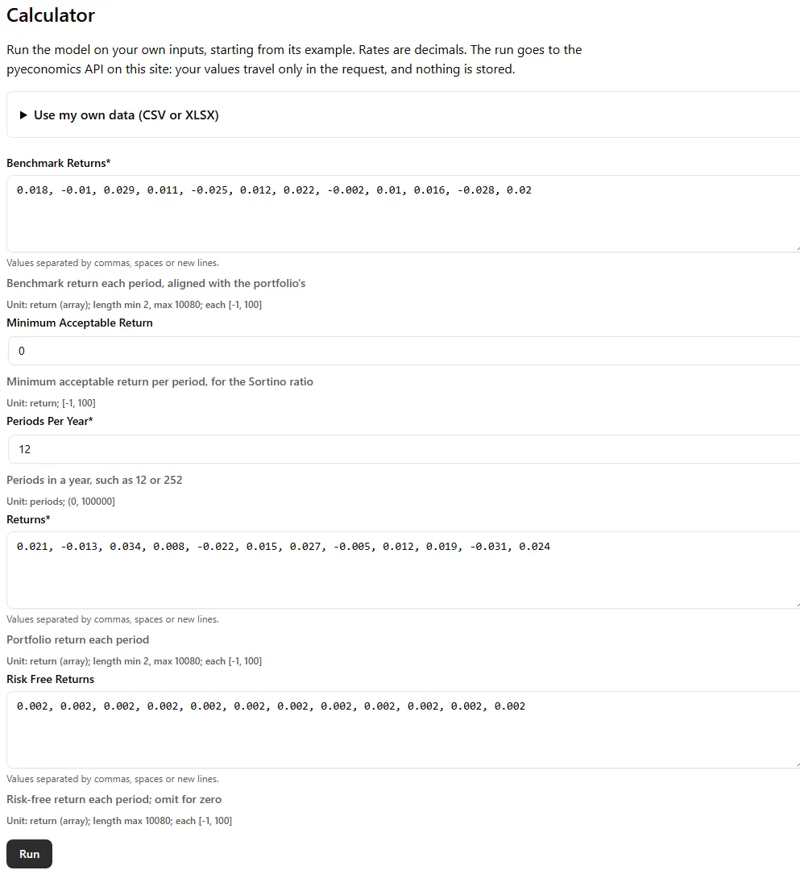 | 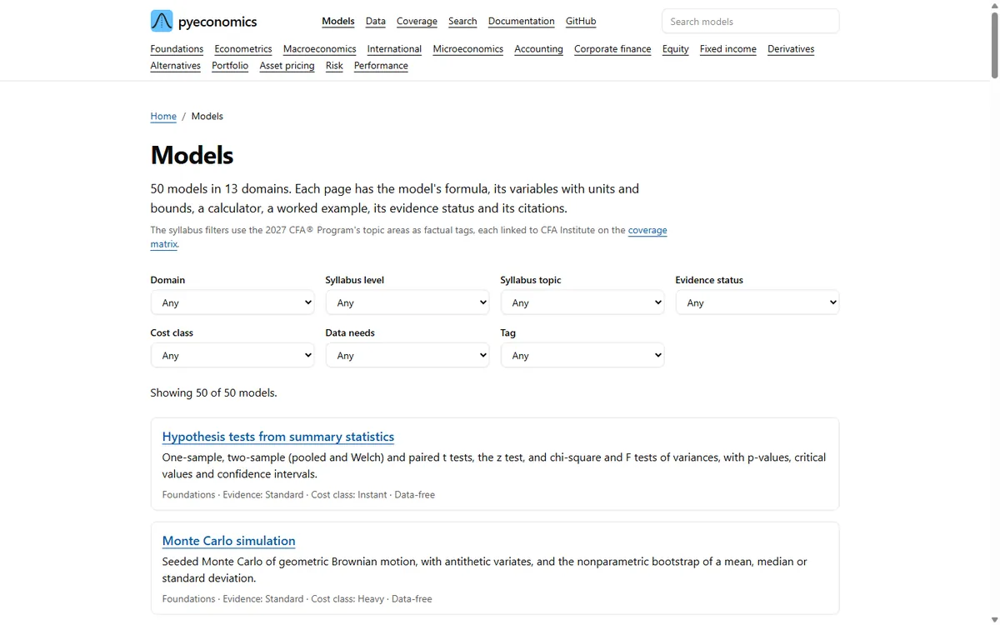 |
| A result's raw values (M4) | The models index (L1) |
