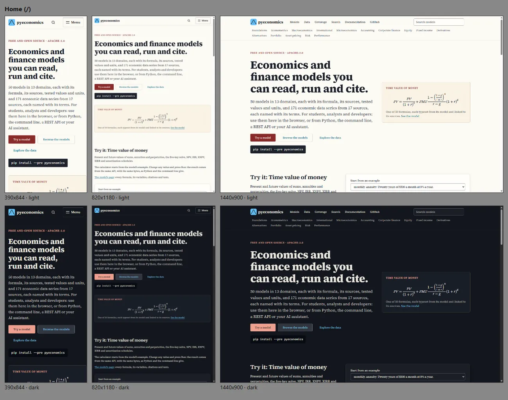
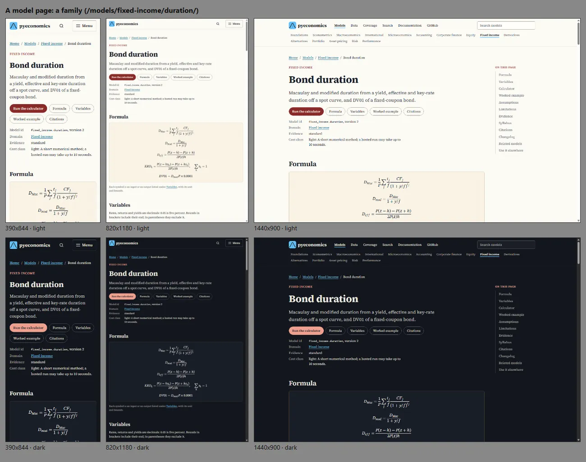
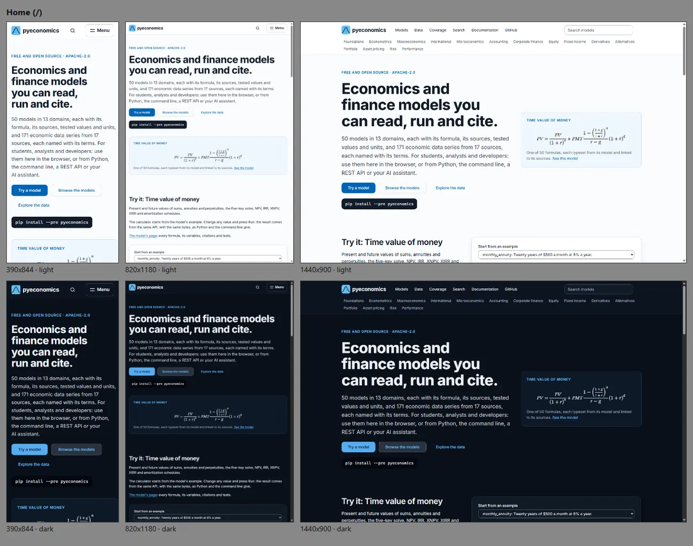
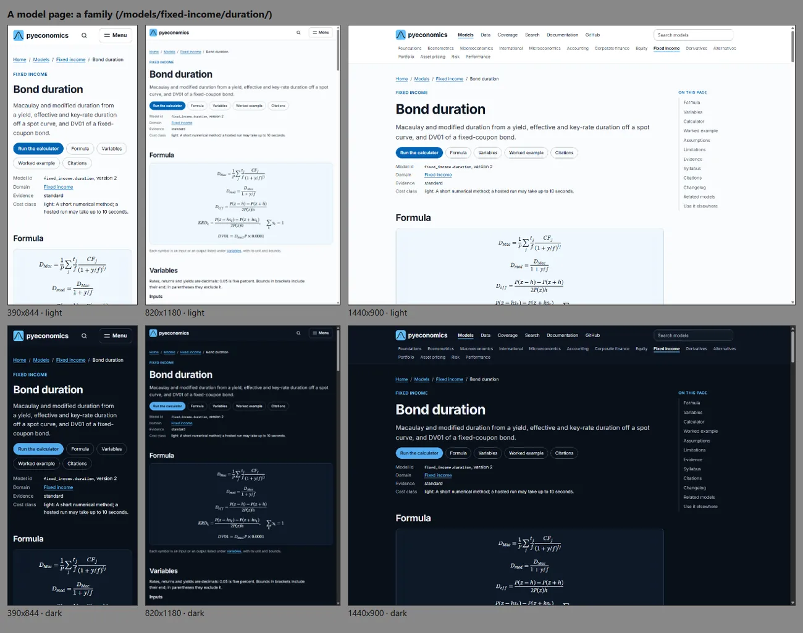
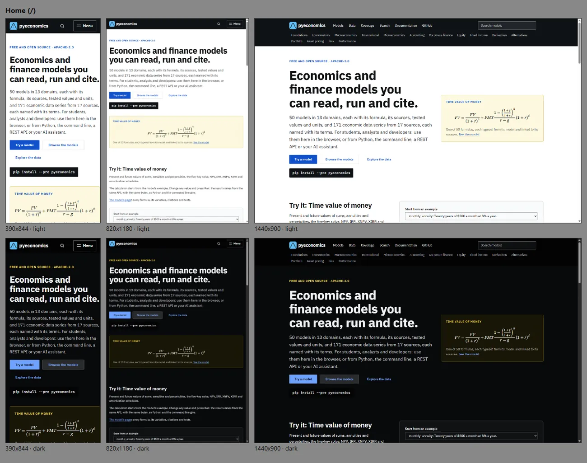
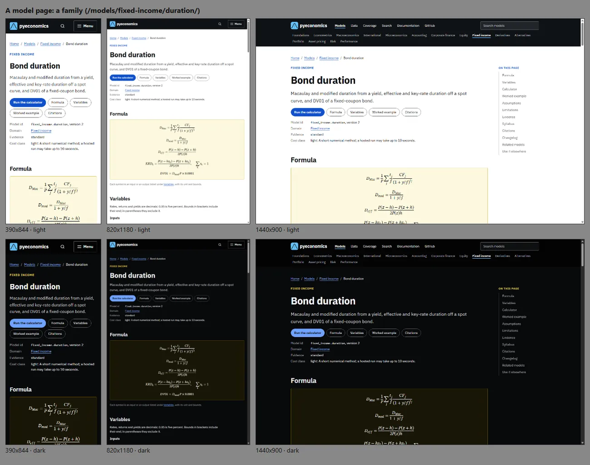

# The site's design direction

Chosen on 2026-11-15 in Phase 5 Step 17, from round 0's findings
([audit-round-0.md](audit-round-0.md)), by a panel of three fresh evaluators. The
maintainer sees the directions in the step's pull request and may overrule there;
their acceptance of the design is one question at Step 20's gate.

## How it was chosen

Round 0 found a site that worked but read as a draft: a stock theme with no
identity (D1, median 5), grey everywhere (D4, 5), flat layouts that buried the
calculator (D2, 5), and formulas in each visitor's own math font. The three
directions below answer the same findings with the same content and layout skeleton
(a home page that shows the product working, model pages laid out around the
formula and the calculator, a one-row phone header), and differ in what a visitor
first feels: the typeface, the palette, the surfaces and the density. Each was built
as real pages on the local build (its tokens in `global.css`, its fonts from our own
origin) and captured by the harness: the home page, `/models/fixed-income/duration/`,
`/models/equity/cape/` and a calculator before and after a run, at three widths in
both themes.

Three panelists, fresh subagents on Claude Sonnet 5.5 (a different model from the
implementer's; Claude Code's subagents run Claude models only), each scored the three
directions with the protocol's rubric from the screenshots alone. They were given no
rationale and no names, only the letters, so nothing but the pages steered them.

## The directions

### A. Textbook (chosen)

A well-set reference book. Round 0's evaluators wanted formulas that "read like a
well-set textbook" (D3's top anchor) and a site a professional would cite (D8); this
direction makes the formula the hero of the page and lets the type carry the
identity: a serif face for text and headings, STIX Two Math for formulas, warm paper
and ink with an oxblood accent for actions, ruled and tinted formula plates, small
radii and almost no shadow. The dark theme is navy ink with a salmon accent, not an
inversion.

| Token | Light | Dark |
| --- | --- | --- |
| background | `oklch(0.985 0.008 85)` | `oklch(0.2 0.015 260)` |
| foreground | `oklch(0.24 0.02 260)` | `oklch(0.93 0.012 85)` |
| primary (actions) | `oklch(0.43 0.13 25)` | `oklch(0.78 0.1 32)` |
| link and focus ring | `oklch(0.45 0.1 235)` | `oklch(0.8 0.09 230)` |
| formula plate | `oklch(0.965 0.02 85)` | `oklch(0.235 0.02 260)` |
| form boundary (input) | `oklch(0.58 0.02 260)` | `oklch(0.6 0.02 260)` |
| text face / radius | Literata (panel: Source Serif 4) / 6 px | |

### B. Instrument

A precise tool. A neutral sans (Inter) for everything, cool neutrals with the brand's
blue carrying actions and focus, tinted formula cards, 12-pixel radii and soft
elevation; a deep navy dark theme. It answers round 0's grey palette and flat
hierarchy with a familiar product look.

| Token | Light | Dark |
| --- | --- | --- |
| background | `oklch(0.99 0.003 250)` | `oklch(0.17 0.025 258)` |
| foreground | `oklch(0.22 0.03 255)` | `oklch(0.95 0.008 250)` |
| primary | `oklch(0.5 0.15 252)` | `oklch(0.72 0.13 245)` |
| formula plate | `oklch(0.97 0.013 240)` | `oklch(0.21 0.035 255)` |
| text face / radius | Inter / 12 px | |

### C. Signal

A high-contrast data terminal. IBM Plex Sans, a near-black header band over white
pages, an electric blue for actions and a signal yellow marking formulas, square
corners and flat surfaces; a near-black dark theme. It answers round 0's missing
identity with the strongest contrast of the three.

| Token | Light | Dark |
| --- | --- | --- |
| background | `oklch(1 0 0)` | `oklch(0.14 0.004 260)` |
| header band | `oklch(0.18 0.01 260)` | `oklch(0.1 0.004 260)` |
| primary | `oklch(0.48 0.2 262)` | `oklch(0.72 0.15 262)` |
| formula plate | `oklch(0.975 0.035 100)` | `oklch(0.2 0.03 100)` |
| text face / radius | IBM Plex Sans / 4 px | |

Every pair of each palette passed the contrast test before the panel saw it: text on
its surface at 4.5:1 and boundaries and focus at 3:1, in both themes.

## The panel's scores

| Panelist | Direction | D1 | D2 | D3 | D4 | D5 | D6 | D7 | D8 | Mean | Rank |
| --- | --- | --- | --- | --- | --- | --- | --- | --- | --- | --- | --- |
| 1 | A | 8 | 7 | 8 | 8 | 6 | 7 | 7 | 8 | 7.38 | 1 |
| 1 | B | 6 | 7 | 7 | 7 | 6 | 7 | 7 | 7 | 6.75 | 3 |
| 1 | C | 7 | 7 | 7 | 6 | 6 | 7 | 7 | 7 | 6.75 | 2 |
| 2 | A | 8 | 7 | 9 | 8 | 6 | 7 | 7 | 8 | 7.50 | 1 |
| 2 | B | 5 | 7 | 7 | 6 | 6 | 7 | 7 | 7 | 6.50 | 3 |
| 2 | C | 6 | 7 | 7 | 6 | 6 | 7 | 7 | 7 | 6.63 | 2 |
| 3 | A | 8 | 7 | 8 | 8 | 6 | 6 | 7 | 7 | 7.13 | 1 |
| 3 | B | 5 | 6 | 5 | 6 | 6 | 6 | 7 | 6 | 5.88 | 3 |
| 3 | C | 6 | 6 | 6 | 5 | 6 | 6 | 7 | 6 | 6.00 | 2 |

Means across the panel: **A 7.33**, B 6.38, C 6.46. All three ranked A first, then C,
then B.

What they said:

- **A:** "the only direction with an identity that matches the product: a typeset,
  citable, textbook feel, with the best formulas and the most polished light and dark
  themes" (panelist 2). Its weaknesses: a small, crowded domain row; serif text at
  small sizes; a long hero paragraph; and, on all three, identifiers that broke
  mid-word in the phone's variable tables and dense calculator results.
- **B:** clean and legible, but "a generic SaaS or documentation template with little
  distinct character" (panelists 1, 2 and 3).
- **C:** a strong technical character, but its yellow plate "clashes" with the blue
  and black, its dark plate looks muddy, and its near-black dark theme is stark.

## What changed after the choice

- **The text face.** Direction A was built on Source Serif 4, whose font file reserves
  the name "Source" (the SIL Open Font License's third condition), and the file the
  site would serve is a subset, a Modified Version under that licence. The face is
  therefore Literata, a serif designed for reading on screens that is closest to
  Source Serif 4 in character, whose licence reserves no name. STIX Two Math reserves
  none either. The direction, its palette and its layouts are unchanged; the
  maintainer can see both faces in the pull request.
- **The panel's notes on A:** the domain row is larger and spaced; the hero paragraph
  is shorter; inline code no longer breaks mid-word (`overflow-wrap: break-word`);
  results show ten significant digits with a decimal's percent; the form's errors
  and success read in plain words.

## Fonts and weight

The text face's upright latin file (52 KB) is the only font every page preloads. Its
italic (about 55 KB) loads only where italic text appears. STIX Two Math's latin file
(394 KB, with its OpenType MATH table) is not preloaded and loads only on a page with
a formula; text never waits for it (`font-display: swap`). Lighthouse's sample holds
the result at 90 or more (the pull request records the run).

## Screenshots

Each image shows a page's first screen at 390, 820 and 1440 wide, light above dark.

| Direction | Home | A model page |
| --- | --- | --- |
| A, Textbook |  |  |
| B, Instrument |  |  |
| C, Signal |  |  |
