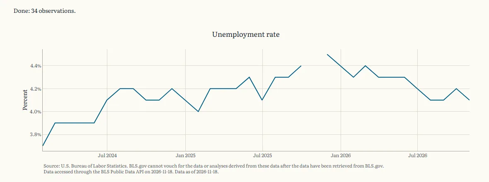
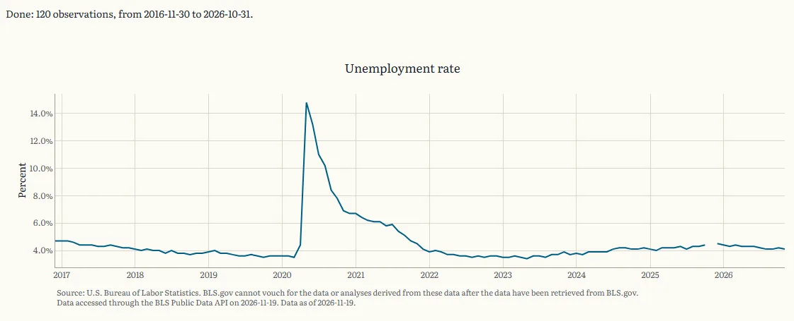
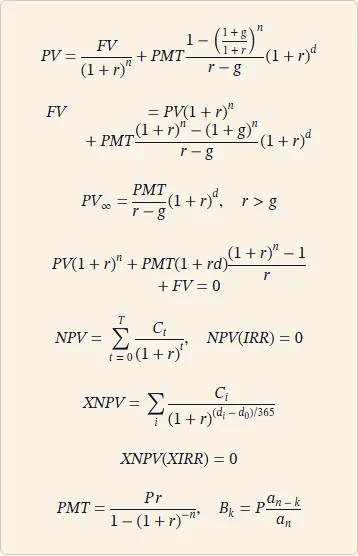
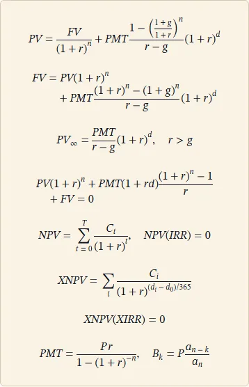

# The confirmation round on staging

Phase 5 Step 18 ends with one round of the protocol in
[dogfooding.md](../dogfooding.md) on the deployed staging site, through Cloudflare
Access: the harness, then five fresh evaluators. It passes with no Blocker or High
finding and a median no lower than [round 3](round-3.md)'s 7.38.

**Where it stands (2026-11-19): the round has run, and its one High finding is
fixed.** The five evaluators' median is 7.38, round 3's exactly. Twenty of the
twenty-one tasks passed, one was hard and none failed. There was no Blocker and one
High finding: the site's copy of the unemployment rate held under three years of a
series that goes back to 1948, and its page did not say so. Step 18's rule for a High
finding here is a fix on its own branch before Step 19 starts: pull requests #370
and #378.
Both are merged and deployed to staging, and the fix was verified there on 2026-11-19:
the site's copy of each BLS series holds 274 months, from January 2004, and reaches
twenty years further back with each daily run, and the unemployment rate's page draws
the ten years it opens on. A fresh evaluator in the student's persona, who had seen
nothing of the round, then did the four tasks on the fixed site: all four passed, with
no Blocker and no High finding.

The round is not run again in full: its median stands as scored, on the deployment
before the fix. Step 18's task says what follows a High finding here, and that is
what was done; Step 19 may start.

This page is in the order things happened: the harness's three runs on staging
before the evaluators could see anything, the three issues fixed meanwhile, the
evaluators' first attempt (not counted), then the round itself.

## The harness on the merge commit's deployment

Staging's deploy of Step 18's merge commit (238e937) succeeded. `npm run dogfood`
against it, run `staging-confirm`: all 138 states answered, with no console error
and no policy violation, but with two kinds of problem the local rounds never had.
Locally the API answers in a few milliseconds and the data is the stand-in world's;
on staging the API is a network away and the data is real.

| # | Found | Cause | Destination |
| --- | --- | --- | --- |
| S1 | Choosing live data on a phone scrolled the page sideways: 504 pixels on a 390-pixel screen, on a model none of whose profiles the site serves | Round 3 had made the profile picker's options long ("Default (United States data): your own computer only"); a select is as wide as its longest option, and a fieldset does not shrink below its content. No check chose live data on a phone | Fixed in #355: where a profile runs is its group's name (`<optgroup>`), an option is a name alone, the fieldset may shrink |
| S2 | A calculator's result arrived as a jump of the whole page: a layout shift of 0.52 to 0.73 in five of the eight captures that ran a model | A browser counts a move within half a second of a press as the visitor's own. A run on staging takes longer than that | Fixed in #355: the result's heading and a skeleton of its outputs, manifest and downloads take their place with the press of Run; the answer changes values, not positions |
| S3 | A series' page moved when its chart arrived: up to 1.18 on a phone | The room held for the chart was sized to the stand-in data, whose source record is shorter than the hosted site's (no line for the site's daily copy, a shorter notice), and round 3 added a line under the chart: 190 pixels short on a phone, 110 at 820 wide | Fixed in #355: the series keeps the room its placeholder held, sized to the hosted record as measured on staging |
| S4 | A source record read as raw text: `served_from_snapshot:` before its sentence, a retrieval time to the microsecond | Only the hosted site's records carry them | Fixed in #355: the sentence, then its code; a time to the minute. The JSON is unchanged |
| S5 | `/search/` shifted by 0.125 in one of its six captures, and its header grew from 56 to 60 pixels a third of a second after it opened | The text font arriving after the first paint, so the page is drawn twice | Issue [#354](https://github.com/pyeconomics-dev/pyeconomics/issues/354): a fallback face matched to the font's metrics, with a check that holds the font back. It belongs to the font loading Step 17 set up |

S1 is a regression of round 3's own fix (its M10), found one deployment later. Each
of S1 to S3 has a check that reproduces it locally, because the local build cannot
show it by itself: a run held back by a second must move nothing, for a long result,
a result of one output and a result with a chart; live data chosen on a phone, each
profile in turn, must keep the page in its width; a series must stand in the room
held for it with space to spare for a longer record.

## The harness on the fixed deployment

Staging's deploy of #355's merge commit (089ce01) succeeded. Run `staging-confirm-2`:
all 138 states passed, none scrolled sideways, none had a stray scroll box, a console
error or a policy violation, and no capture or task state shifted by more than 0.011
(before the fix: seven above 0.1). The run's 1,359 output files were searched for the
Access service token's two values, and none holds either.

## The three issues the loop filed, fixed

The loop left three findings as issues ([summary](summary.md), "What is left"). The
maintainer asked for all three to be fixed before the evaluators' pass, each in a
pull request of its own:

| Issue | What changed | Pull request |
| --- | --- | --- |
| #354, a late text font moves the page | Fallback faces over the system serifs with the text font's metrics, and a check that holds every font file back | #358 |
| #350, the formulas' typography | A word in a subscript or superscript is upright; no formula is wider than a phone's screen | #363 |
| #351, the bond models' first example | Each opens on a five-year bond with a 4% annual coupon at a 5% yield, and a price says it is per 100 of face value | #365 |

What the first of them does not reach is written down, with its measurements, in
[direction.md](../direction.md) ("Late fonts") and issue #359: a late font can still
rewrap a paragraph on a Linux desktop at ordinary density, and macOS, iOS and Android
were not measured.

Staging's deploy of #365's merge commit (638696e) succeeded. Run `staging-confirm-3`,
on 2026-11-18: all 138 states passed, none scrolled sideways, none had a stray scroll
box, a console error or a policy violation, and no capture or task state shifted by
more than 0.013. Its 1,358 output files hold neither value of the Access service
token. Measured on the same deployment at a phone's width, all 247 display formulas
fit the plate that holds them; before #363, 54 of 194 did not.

The evaluators' pass ran on a deployment that holds these ("The round", below).

## The evaluators' first attempt, which is not counted

On 2026-11-17 five fresh evaluators on Claude Sonnet 5.5 were started on the fixed
deployment, one per persona, with the protocol's prompt word for word and the working
notes of rounds 1 to 3, changed only for where the site is and how the browser tool
signs in to it.

**None of them could see the site.** On the maintainer's machine a gateway removes
images from what an agent reads, so that no client document can reach a model, and
by this round it removed every screenshot an evaluator opened. One evaluator stopped
at once and said so. Two returned scores and said in their findings that the four
visual dimensions were scored from text and accessibility trees and were unverified.
The other two were stopped by the implementer once three had reported the same
thing. **No score from this pass is counted**: the protocol judges what a visitor
sees, and none of these saw it. In rounds 2 and 3 the evaluators described details
only a picture shows and reported no removal, so those rounds stand.

What two of them could read as text, checked:

| Said | Checked |
| --- | --- |
| On a phone, pressing Run showed no result | Not reproduced: a run on staging at 390 wide reads "The run finished: 16 outputs, no warnings." The tool had pressed the link "Run the calculator" before the form loaded |
| Filling the field labelled "Search" timed out on a phone | The tool's fault: it took the first control with that label, the header's hidden box, and a link that shares the label. It now takes the first such control in view (dogfooding.md's change log, 2026-11-17) |
| The bond models take dates, and a price has no unit a learner knows | Issue #351, as in all three rounds |
| An error about two inputs sat under one of them | Not reproduced: the check that both fields are marked passes |
| A search result's excerpt for a domain page begins with a stray fragment | Low; the round's phone evaluator saw it too, and it is in issue #371 |

**What it waited for.** Lifting the gateway for the site's own screenshots was the
maintainer's decision, not an agent's to work around. On 2026-11-18 the maintainer
changed it: an agent on that machine may now read the pictures under the harness's
output folder and the baselines folder, and no others. A picture was read by the
implementer, and two by a throwaway subagent, before anything else was started.

## The round

Run on 2026-11-18 and 19 (UTC) on staging's deployment of fae06ec, which holds every
fix above. Five fresh evaluators on Claude Sonnet 5.5, one a persona, each given the
protocol's prompt word for word and the first attempt's working notes with only the
run's name changed (the prompts as sent were compared with the saved ones: identical).
Each did its tasks in Chromium through `tests/dogfood/visit.ts` (37 to 49 visits each,
the after-scoring pass included) and read the harness's pictures. All five described
what only a picture shows.

### The harness, before the evaluators

Run `staging-confirm-4`: all 138 states passed, none scrolled sideways, none had a
stray scroll box, a console error or a policy violation. One capture shifted by more
than 0.1:

| Found | Cause | Destination |
| --- | --- | --- |
| The OLS model's page at 820 wide in dark shifted by 0.313; its light twin by 0.013, as in every run before | A late text font. Forty repeats gave 0.013 or 0.014. Holding the text font's file back by 150 ms reproduces 0.313 every time: the block above the formulas rewraps (the jump links move down 30 pixels, the facts list grows by 23). Held back 300 ms or more, the same rewrap scores 0.044 | Issue [#359](https://github.com/pyeconomics-dev/pyeconomics/issues/359), which holds what #358's fallback faces do not reach: this adds Windows, a tablet's width and a font that arrives just after the first paint, with the measurements |

After the evaluators finished, the run's 1,942 files (the harness's and the
evaluators' own visits) were searched for the Access service token's two values:
none holds either.

### Scores

| Dimension | P1 candidate | P2 developer | P3 student | P4 first visit | P5 phone | Median | Round 3 |
| --- | --- | --- | --- | --- | --- | --- | --- |
| D1 First impression and identity | 8 | 8 | 8 | 8 | 8 | **8** | 8 |
| D2 Hierarchy and layout | 7 | 7 | 7 | 8 | 7 | **7** | 7 |
| D3 Typography and formulas | 8 | 8 | 8 | 8 | 7 | **8** | 8 |
| D4 Colour, contrast and theming | 8 | 8 | 8 | 8 | 8 | **8** | 7 |
| D5 Interaction, feedback and motion | 7 | 8 | 7 | 7 | 7 | **7** | 7 |
| D6 Navigation and findability | 7 | 7 | 7 | 7 | 7 | **7** | 7 |
| D7 Content and microcopy | 7 | 7 | 6 | 6 | 7 | **7** | 6 |
| D8 Trust and polish | 8 | 8 | 6 | 7 | 7 | **7** | 8 |
| Mean | 7.50 | 7.63 | 7.13 | 7.38 | 7.25 | **7.38** | 7.38 |

The round's median, the median of the five means, is **7.38**: round 3's, to the
hundredth. Colour and content each rose by one and trust fell by one, on the student's
6 for the page that drew three years where it promised ten. No evaluator scored a
dimension below 6.

### Tasks

| Persona | Task 1 | Task 2 | Task 3 | Task 4 | Task 5 |
| --- | --- | --- | --- | --- | --- |
| P1 candidate | pass | pass | pass | pass | |
| P2 developer | pass | pass | pass | pass | |
| P3 student | **hard** | pass | pass | pass | |
| P4 first visit | pass | pass | pass | pass | |
| P5 phone | pass | pass | pass | pass | pass |

Twenty passed, one was hard, none failed (round 3: 17, 4, 0). The candidate's
pricing task, "a 5-year bond with a 4% annual coupon at a 5% yield", was hard in all
three rounds and passes: the calculator opens on that bond (#365).

### The High finding, and its fix

**H1. A series' page drew under three years of a history it holds decades of, and
said nothing** [P3; task 1 hard]. The student was asked for the US unemployment rate
"as a chart over the last ten years". The date boxes read ten years, the chart began
in January 2024, the status read "Done: 34 observations.", and typing an earlier
start drew the same 34 with no word. The only hint was a line in the Sources box, far
below.

- **Checked.** Staging's API, asked for the series from 2000, answered 34
  observations, 2024-01-31 to 2026-10-31.
- **Cause.** The Bureau of Labor Statistics answers a request without dates with its
  latest three years only. The site's daily copy read each series "whole", which for
  BLS is a request without dates. This is Step 8's snapshot, and no local round could
  show it: the local build's stand-in data runs from 2018.
- **How far it reached.** The 104 series the site serves without parameters were
  asked for their whole history, and 79 answered: the five BLS series (the
  unemployment rate and four CPI series) each held 34 months, and none of the other
  74 was cut short. Of the 25 that did not answer, 20 are Penn World Table series the
  rate limit turned away, from the one file whose other 29 series all begin in 1950,
  and 5 are Treasury curves, which take both dates and are read by window already.
- **Fixed in #370 and #378.** Each BLS series is read from its first year (1913 to
  1957, each first observation checked against BLS), twenty years a run. The series
  page now says the dates a series runs between, and says so when the start asked
  for is earlier than anything held: a shorter history for any other reason can no
  longer pass in silence.
- **The fix's first run went wrong, on staging only.** With #370 deployed, the copy
  job was run by hand, and each BLS series came out with two observations, not
  twenty years. The writer joined a run's parts onto the history it held only when
  their metadata was equal, and a BLS notice carries the day it was read, as BLS's
  terms ask: the frame held from the day before was never "the same series", so each
  history started again from its last 45 days. Staging was put back within the hour
  by the runbook's rollback (its manifest pointed at the previous BLS object, 34
  observations again); production runs its own image and was not touched. #378
  makes the writer compare what a history's numbers are, not its terms. #370's tests
  used scripted sources whose notices never change; #378 adds one whose notice
  does, and a rule: before a source is first read by window, the writer is
  rehearsed against the source itself (for BLS: 34 observations as held, then 274
  from 2004, then 514 from 1984).
- **Its checks.** A test holds every BLS entry to a declared start; the explorer's
  line has unit tests and an end-to-end test that asks for 1900; and
  `tests/staging/explorer.spec.ts`, which `deploy-staging.yml` runs after every
  deploy, now fails if the unemployment rate's default window is not held.

**Verified on staging, 2026-11-19.**

- After #378's deploy (bb5991b) the copy job was run by hand. Its log: five BLS
  series written, and no history started again.
- Staging's API, asked for each of the five series from 1900, answers 274
  observations from 2004-01-31, where it answered 34. Asked for the unemployment rate
  from ten years back, as its page asks, it answers 120 observations from 2016-11-30.
- The harness, run a fifth time on that deployment (`staging-confirm-5`): 138 states
  passed, none scrolled sideways, none had a console error or a policy violation,
  and nothing shifted by more than 0.013. The series page, with its longer status
  line, did not move at any size. The run's 1,455 files, the evaluator's visits
  among them, hold no value of the Access token.
- The deployed check added for this class passes there
  (`tests/staging/explorer.spec.ts`, four of four).
- **A fresh evaluator in the student's persona**, on Claude Sonnet 5.5, with the
  round's own prompt and no knowledge of the round, did the four tasks on the fixed
  site in 31 visits. All four passed; of the first it wrote: "The series page draws a
  ten-year chart by itself (2016-11 to 2026-10, 120 observations) with no wrong
  turn." It found no Blocker and no High. Its scores were 8, 7, 8, 8, 7, 7, 6 and 7, a
  mean of 7.25 where the round's student gave 7.13; they are not added to the round's
  median. Its 8 Medium and 7 Low findings are those of issues #371, #372, #374 and
  #375 again, with their new details noted on #374 and #375: the chart is below a
  wide screen's first screen, "120 observations" counts a month that holds no value,
  and five wordings.

| The round | After the fix |
| --- | --- |
|  |  |

### Medium and Low findings

The five evaluators returned 26 Medium and 32 Low findings. None stopped a task.
Merged by page and cause they are 19 Medium and 27 Low findings. Every Medium and 20
of the Low are in seven issues, each filed where whoever works on that part of the
site will read it:

| Issue | What it holds | Medium | Reported by |
| --- | --- | --- | --- |
| [#371](https://github.com/pyeconomics-dev/pyeconomics/issues/371) | Search: the box is not focused when opened from the header; a page opened with a query says "Type to search" until its results come; an exact title ranked below others; excerpts with words run together | 3 | P1 P2 P3 P5 |
| [#372](https://github.com/pyeconomics-dev/pyeconomics/issues/372) | A phone: no About or legal links in the menu and a header that leaves with the scroll; the calculator's boxes inside boxes, with a select that cuts its text off; seven filters before the first model; formulas that fit but are small | 4 | P4 P5 P3 P2 |
| [#373](https://github.com/pyeconomics-dev/pyeconomics/issues/373) | The calculator's errors: a list field left unmarked; a problem page written for developers | 2 | P1 P5 P2 |
| [#374](https://github.com/pyeconomics-dev/pyeconomics/issues/374) | Series pages and live-data results: a download's message out of sight; a projection dated 2036 that reads as data; the values a run read, shown nowhere | 2 | P3 |
| [#375](https://github.com/pyeconomics-dev/pyeconomics/issues/375) | Words: source and series counts that differ page to page (17, 31 and 12; 171 and 110); "tests" promised on a model's page; internal terms | 3 | P4 P3 P5 P1 |
| [#376](https://github.com/pyeconomics-dev/pyeconomics/issues/376) | For a developer: two narrow code boxes; REST and MCP in prose on the home page; thin install guidance; an example that reads no output; a curl host and its limits unsaid; what a manifest's hashes cover; which client a configuration is for | 7 | P2 |
| [#377](https://github.com/pyeconomics-dev/pyeconomics/issues/377) | The time-value model opens on a rate of 0.0066… (8% a year over twelve months): issue #351's class on another model | 1 | P4 P5 P1 |

Seven Low findings went elsewhere:

| Low finding | Destination |
| --- | --- |
| The OLS page's shift of 0.313 in the harness's table [P5] | Issue #359, above |
| A harness capture of the duration page on a phone in dark is blank over its lower 360 pixels [P1, who could not reproduce it] | The harness's fault, fixed: below |
| A rejected run is logged by the browser as a console error [P1] | Disputed: a browser logs every failed request, a visitor never sees the console, and the page handles the answer |
| A price's unit reads "money", and a value shows ten digits [P1] | Disputed, as in every round: the models hold no currency. What a price is per is in the field's words since #365 |
| Five formulas share one plate, with no captions [P1] | Disputed, as in rounds 2 and 3: a model's card gives a list, with no groups to lay out |
| "Loading the calculator…" stands over empty bars [P1] | As round 3's L2: the bars are the placeholder that holds the form's room |
| A source's notice is on the chart, under it and in Sources [P3] | By rule, as round 3's L14: a chart carries its attribution on itself |

### What was checked before it was believed

| Said | Checked |
| --- | --- |
| The unemployment chart starts in 2024 [P3] | True: the picture, and the API's 34 observations |
| The home page, `/about/`, `/sources/` and `/data/` give different counts [P4] | True: the four pages' text |
| `/newsletter/` never mentions 1.0 [P4] | True: only the footer's version line does |
| The "Calculation" select cuts its text off on a phone; the rate reads 0.0066… [P4 P5] | True: the picture |
| A capture of the duration page in dark is half blank [P1] | True of the picture, and not of the page: see below |

**The harness's fifth fault.** That capture is taken after a task chooses the
duration model's third example. Choosing it gives the picker focus, the browser
scrolls it into view smoothly over about a second, and the harness took its picture
on the way: the part of the page not yet painted was the blank strip. Repeated on
staging, five captures of six had it; a second and a half later the page is whole.
The harness now waits until the page has stopped scrolling (six of six whole), dated
in the protocol's change log. The evaluator who saw it rated it Low and said it might
be the capture's doing, which it was.

### The check of round 3's list

After scoring, each evaluator was shown [round 3](round-3.md)'s merged list of 32
items and said of each whether it was fixed, still there or worse. That pass changed
no score. Of 160 judgments, 99 were "fixed", 60 "still there", none "worse" and one
"not checked".

| Judged by at least four of five | Items |
| --- | --- |
| Fixed (19) | M1 and M2 (the bond models: #365), M3 (formulas wider than a phone: #363), M4, M5, M6, M8, M11, M13, L1, L3, L5, L6, L7, L10, L11, L16, L17, L18 |
| Still there (11) | M7, M9, M10, M12, L4, L8, L9, L13, L14, L15, L19 |
| Split, three to two (2) | L2, L12 |

Every item still there is one round 3 disputed or fixed in part, with its reason in
that round's record: the page's order, the header's two rows, the formulas' one
plate, "On this page", the notices a chart must carry. Nothing round 3 fixed has
come back. Of the two split items: L2's placeholder is bars shaped like the form's
fields, which two evaluators still read as an empty box; and L12's two counts now
agree, while two evaluators point at a third, the variables table's count of the
outputs a calculation declares, which can be one more than a run returns (noted on
issue #373).

## The visual baselines, looked at

The commit that drew the 52 baselines, and the description of pull request #352, say
each picture was looked at before it was committed. That was not so: the session that
committed them could not see images, and had checked them by count, size and name.
They were then checked by two means that need no eye: by text (the only text in a
first screen that names the site's operator or gives a mail address is the privacy
policy's contact paragraph, which the comparison masks) and by pixels (exactly four
pictures, the privacy page's, hold the mask's colour, each as one solid rectangle of
that paragraph's size and place). #363 redrew 14 of them, again unseen, checked by
the box in which each differed from the picture before.

**On 2026-11-18 all 52 were looked at**, one by one, the 14 among them. Each shows the
page its name says, whole, at its width and in its theme: the header, the title and
the content, with nothing clipped and nothing overlapping. The privacy pages show
the mask as one solid block over the contact paragraph, and no picture holds
personal data.

**Looking found what measuring had not.** #363 wrote the long formulas over two
lines, and was checked for width. In the pictures, a two-line formula's left side
stood apart from its "=", and its second line began to the left of the first: such
a formula is a table, and Chromium's MathML centres every cell of one, having no
`columnalign`. It was so on 14 model pages. Fixed in #369: the stylesheet aligns
the cells as the formula asks, and the test that opens every model's page now
measures every row of every such table.

| Before | After |
| --- | --- |
|  |  |

Six baselines were redrawn by the web job
(the time value page's four, and the GARCH page's two at 1440 wide), each was
looked at before it was committed, and the other 46 are the same in every pixel.

## Beside the round

- **The gate, again.** GitHub withdrew the picomatch advisory on 2026-11-18, the day
  after its dated exception was added. The audit stopped reporting it, the entry
  matched nothing, and the check that reads the exceptions fails on an entry that
  matches nothing: every commit failed the gate on the exception itself. #368
  removed the entry and closed issue #360; the exceptions file is empty.
- **A staging-health alarm** (issue #367): one probe of eighteen timed out, at 14:20
  UTC on 2026-11-18, with no deploy near it; the two since passed. Noted on the
  issue and left to the maintainer.

## Cost

- **Harness:** 4.6, 4.5, 4.9 and 4.6 minutes for the four runs of 138 states on
  staging before and in the round.
- **Evaluators, the first attempt:** about 257,000 tokens for the three that
  reported, none of it a counted evaluation.
- **Evaluators, the round:** 1,322,072 tokens for the five, both passes, as the
  platform reported each (300,313; 283,940; 275,239; 245,720; 216,860). A first
  pass took 7 to 22 minutes and a second 9 to 33, the five in parallel. The
  throwaway subagent that proved a picture could be seen used 76,152.
- **The re-check:** the harness's fifth run, 4.4 minutes; one evaluator, 237,088
  tokens in 17 minutes.
- **Implementer:** two and a half hours on 2026-11-17 from the first harness run to
  #355's fixes; on 2026-11-18 and 19, the look at 52 baselines, the round, and four
  pull requests beside this record (#368, #369, #370 and the record's own).
