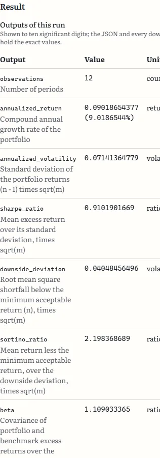
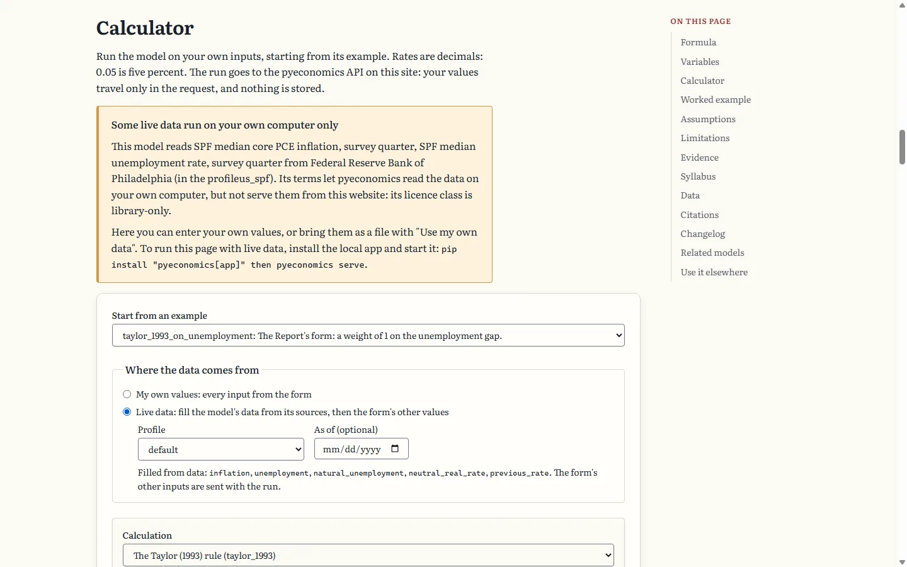
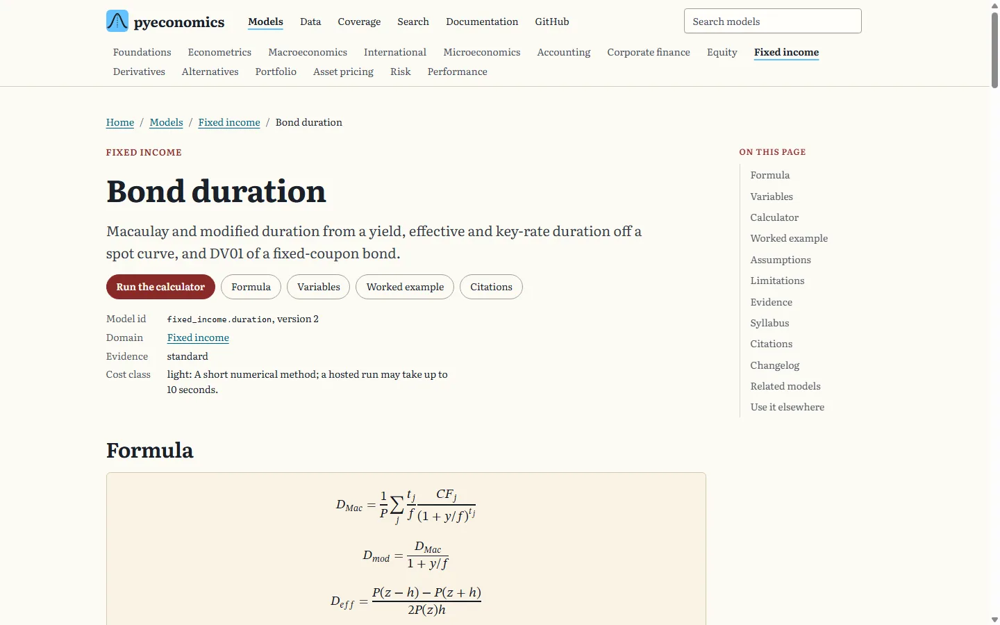
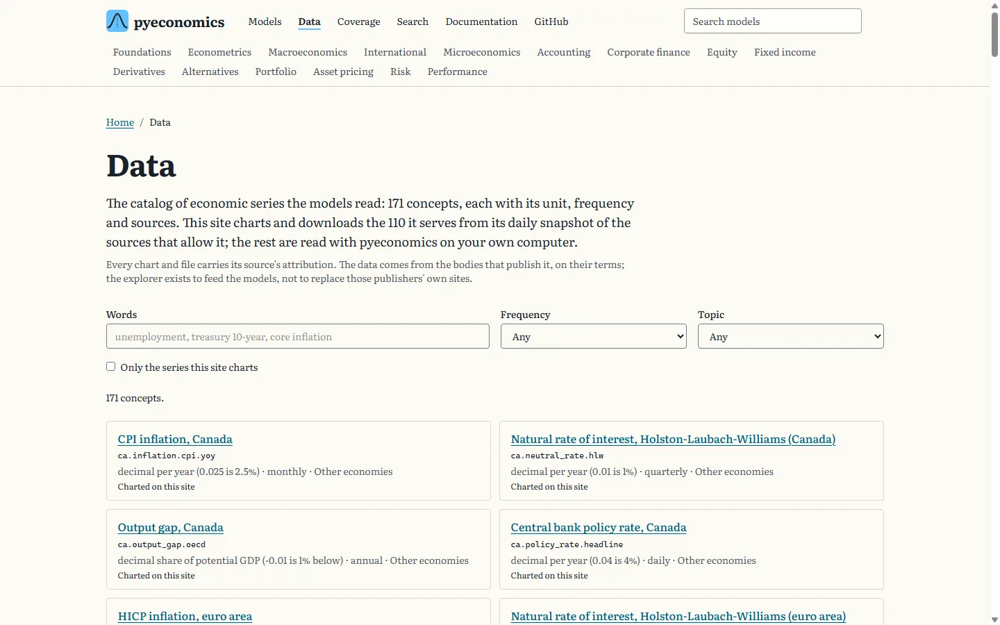
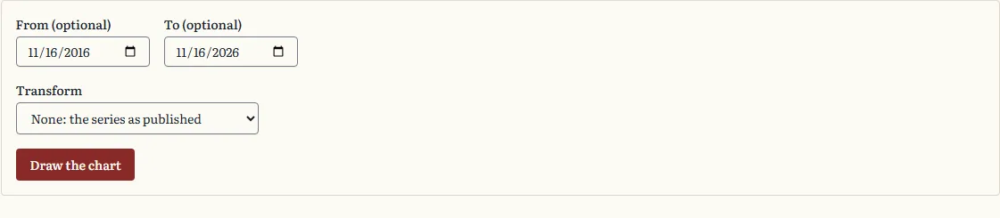
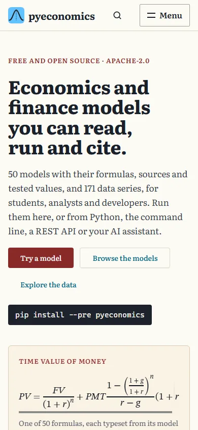

# Dogfooding round 1: the design as Step 17 built it

Round 1 of the protocol in [dogfooding.md](../dogfooding.md), run on 2026-11-16 in
Phase 5 Step 18. It looked at the site as Step 17 left it: the "Textbook" direction
([direction.md](../direction.md)) across every page type, with round 0's High
findings fixed and its open list ([audit-round-0.md](../audit-round-0.md)) still
open.

- **Site:** the local production build (`wrangler dev` on `main` at 19fcdf4, with
  `tests/web/e2e_api.py` answering the API over the catalog world's stand-in data).
- **Harness:** `npm run dogfood`, run `round-1`: 18 page types at 390x844, 820x1180
  and 1440x900 in light and dark (108 captures), and 30 task states. All 138 passed,
  with no sideways overflow, stray scroll box, console error or policy violation.
  Thirteen page captures shifted by more than 0.1 as they loaded (the worst 0.232).
- **Evaluators:** five fresh subagents, one per persona, that had seen nothing of the
  implementation. Claude Code's subagents run Claude models only, so they ran on
  Claude Sonnet 5.5, a different model from the implementer's (Claude Fable 5.2) and
  the model round 0 used, which keeps the two rounds' scores comparable. Each was
  given the protocol's prompt word for word and, after it, working notes that change
  no rule: where to run `visit` and under which run name, to skip the project's
  session-start routine and read no memory, handoff or source file, that the local
  site answers data requests with stand-in values, and to return only the JSON. Each
  did its tasks in Chromium through `tests/dogfood/visit.ts` (5 to 16 visits each)
  and read the contact sheets.
- **After scoring**, each evaluator was shown round 0's merged list and said which
  items it found fixed, still there or worse. That pass changed no score.

## Scores

| Dimension | P1 candidate | P2 developer | P3 student | P4 first visit | P5 phone | Median | Round 0 |
| --- | --- | --- | --- | --- | --- | --- | --- |
| D1 First impression and identity | 7 | 8 | 7 | 8 | 8 | **8** | 5 |
| D2 Hierarchy and layout | 7 | 7 | 7 | 7 | 7 | **7** | 5 |
| D3 Typography and formulas | 8 | 8 | 8 | 8 | 8 | **8** | 6 |
| D4 Colour, contrast and theming | 8 | 8 | 7 | 7 | 8 | **8** | 5 |
| D5 Interaction, feedback and motion | 7 | 7 | 5 | 7 | 6 | **7** | 6 |
| D6 Navigation and findability | 7 | 6 | 6 | 6 | 6 | **6** | 6 |
| D7 Content and microcopy | 5 | 7 | 6 | 6 | 7 | **6** | 6 |
| D8 Trust and polish | 7 | 8 | 7 | 6 | 7 | **7** | 6 |
| Mean | 7.00 | 7.38 | 6.63 | 6.88 | 7.13 | **7.00** | 5.75 |

The round's median, the median of the five means, is **7.00**, up **1.25** from round
0's 5.75. The design's own dimensions moved most: identity, layout, typography and
colour each rose by two or three. Navigation and content did not move, and
interaction rose by one: what was left was in the calculator, the explorer and the
words.

## Tasks

| Persona | Task 1 | Task 2 | Task 3 | Task 4 | Task 5 |
| --- | --- | --- | --- | --- | --- |
| P1 CFA® Program candidate | hard: the formulas' symbols are not defined | hard: price is another model; a dozen fields; the result far below | pass | pass | |
| P2 Python developer | pass | pass | pass | pass | |
| P3 economics student | hard: no way in to "unemployment"; the first click on "Draw the chart" did nothing | hard: nothing says how to cite the series | hard: the live-data notice contradicts a live run that works | pass | |
| P4 first-time visitor | pass | hard: who makes it is not said | pass | hard: the 1.0 notice is only in the footer | |
| P5 phone visitor | pass | hard: the result's unit column is cut off | pass | hard: the tool could not open the menu (the harness's fault, below) | pass |

Of 21 tasks, 12 passed, 9 were hard and none failed. Round 0: 9, 12 and none.

## Findings

Merged across personas; the personas who found each are in brackets. "Fixed" means
fixed in this round's implementer pass, on this step's branch, with every gate green;
round 2's evaluators judge the fix.

### Blocker

None.

### High

| # | Finding | Destination |
| --- | --- | --- |
| H1 | A formula's symbols are never defined, and five formulas share one plate with no names; the variables tables give code names, not symbols (round 0's H6) [P1] | Fixed, and issue #343 closes: every model declares what its formulas' symbols stand for (`symbols=` on `@model`, 756 definitions across the 50 models, each held to a formula and a field by `registry.validate()`), its card lists them, and each model page shows them as "Where" under the formulas, typeset as the formulas are |
| H2 | On a bound model the notice "Some live data run on your own computer only" names one profile's sources above a default profile that runs on the site, and its text ran "profile" into the profile's name [P3] | Fixed: the notice names the profiles that run here first, then what each other profile reads and from whom (`models.ts liveNotice`), with a test that the order holds |
| H3 | A result's table is wider than a phone: the unit column is cut off, and reading it means scrolling sideways [P5] | Fixed: two columns of fixed width, the unit under its value; a check measures three models' results at 390 wide |

### Medium

| # | Finding | Destination |
| --- | --- | --- |
| M1 | A run's result lands far below a long form, with no clear sign that the run finished or which data it used [P1 P2 P3 P4] | Fixed: the result comes into view at once (the glide over a dozen screens left the form on screen), and opens with a line saying the run finished, with how many outputs and warnings and, on live data, how far the observations run |
| M2 | Names read as code: examples (`monthly_annuity`), options (`act_act_icma`), outputs (`full_price`), labels in Title Case (round 0's M6 and M4) [P1 P3 P4 P5] | Fixed: examples, outputs and fields are named in words, with the id beside an output; an option reads as its name with its id beside a name that does not spell it ("Actual/Actual ICMA (act_act_icma)"). Not changed: the unit "money", which is the models' own (they hold no currency) |
| M3 | A form of a dozen fields, conventions before the inputs a run needs, optional inputs mixed in; no textbook example in years [P1 P4] | Fixed: the fields a run needs come first in the model's own order, two to a row on a wide card, and a field that may be left out waits in a disclosure that names it. Disputed: a "years to maturity" shortcut or another example is the model's to give (its inputs are dates so accrued interest is exact), not the page's |
| M4 | An error about two inputs together shows only in a box under the form, in the API's words ("price_from_yield: Value error, ..."), twice [P1] | Fixed: once, in a reader's words, in the box and under each field the message names |
| M5 | On a concept's page the chart is not drawn until asked, and a click on "Draw the chart" before the explorer had loaded did nothing (round 0's M8) [P3] | Fixed: the chart draws when the explorer comes into view, and the button is off until the explorer can answer it |
| M6 | Nothing says how to cite a series (round 0's M10) [P3] | Fixed: "Cite this series", a line built from the source record (publisher, series, how far it runs, when it was retrieved) and the page's address, with a copy button |
| M7 | /data/ lists 171 series in id order, opening on Canada's, with the search a small field among filters [P3] | Fixed: the search first and larger; with no words typed the series are grouped by topic, with links that jump to each topic |
| M8 | No page says who makes the site [P4] | Fixed in part: the home page ("Who runs this site") and every footer ("About this site") link the legal index, which names the operator and how to write to them. The maintainer's name is not put on the home page without their word |
| M9 | "Cited" and "Tested" on the home page only claim [P4] | Fixed: each gives its count from the registry (citations, cited reference values, properties) and links a model's citations and evidence |
| M10 | Whether a visitor can be told when 1.0 ships is only a footer form [P4] | Fixed: while the version is a preview, a line under the install command says so and links the newsletter |
| M11 | The phone menu's capture shows a half-transparent panel in light and no menu in dark, and the `visit` tool could not open it by name [P5] | The harness's faults, not the site's: a capture now waits for animations to end, and `visit` finds a disclosure's summary (dogfooding.md's change log, 2026-11-16). The same fault kept P2 from opening the snippets with the tool |
| M12 | The home page's formula is cut at the plate's edge on a phone [P5] | Fixed: a display formula is set at the text's size below 640 pixels |
| M13 | The run as Python, a command, curl or MCP is in a closed disclosure under the result (round 0's M13) [P2] | Fixed: always in view beneath the form, one at a time, chosen from a row of buttons |
| M14 | A model has two MCP tool names (its own tool and `run_model`) and nothing says how they relate [P2] | Fixed: the MCP snippet and "Use it elsewhere" say that both give the same result |
| M15 | The MCP server is far down the home page, and the site has no page of its own on using it from code [P2] | Fixed in part: the home page's first paragraph links its code section, and that section says what the two tools are. No new page or navigation entry: the documentation's MCP page holds the setup, and the header has no room for another link at 1024 pixels |
| M16 | A result's reproducibility is a sentence and a link; no hash is shown beside it (round 0's M14) [P2] | Fixed: "Manifest", a disclosure under the result with the model and package versions and the two SHA-256 hashes, with a copy button |
| M17 | The duration page gives no plain definition before its formulas [P1] | Fixed by H1 as far as the page can: each symbol is defined. The summary is the model card's own |

### Low

| # | Finding | Destination |
| --- | --- | --- |
| L1 | The explorer's chart is titled by the source's series title and its axis reads "Units" [P3] | Fixed: the concept's own title heads the chart, and a decimal rate's axis reads "Percent". (The "Stub series" title was the stand-in data's) |
| L2 | A model page has no one-line plain explanation under its title [P3] | Disputed: the lead under the title is the model card's summary; a second one would be written by hand for one model |
| L3 | The header's two rows of domain links are heavy, and "Data sources" is only in the footer (round 0's L6) [P3 P4] | Disputed for the row: two of the four evaluators who judged round 0's finding called it fixed, and the row keeps every domain one click away (ADR-0013 decision 10). /data/ now links the sources |
| L4 | /sources/ is one long list with no grouping, and "snapshotted" is jargon (round 0's L3) [P3] | Fixed: "Served on this site" and "On your own computer only", each with why and a marker on each source, a jump list, and "this site's copy" for the snapshot |
| L5 | "Free" is only in the small line above the headline [P4] | Fixed: "50 free models" in the first paragraph |
| L6 | A word runs into the link after it ("thecitations"; in the Terms, "at/mcp") [P1 P4] | Fixed at all nine places (Astro drops a line break between a word and an inline element), with a check over every built page, which found the ninth |
| L7 | "On this page" has twelve entries [P4] | Disputed: it lists every section, so the list and the page agree |
| L8 | A select cuts its text short on a phone [P5] | Fixed: an example's note sits under the picker, where it wraps, and a calculation's name no longer carries its id |
| L9 | Pages shift as a calculator or the search results load (round 0's M12) [P5 P2 P4] | Fixed: each calculator's card holds the room its form will take, the explorer its chart's, the search page its results'; a check holds every sample page under 0.1 at three sizes |
| L10 | "Explore the data" is a bare link beside two buttons [P5] | Fixed: a third button |
| L11 | Related models repeat the domain's name and are not in order of closeness [P1] | Fixed in part: each card gives the model's summary. The order is computed from shared topics, tags and citations, and stays |
| L12 | A long list in the Python sample runs off a phone's code box [P2] | Fixed: a long list goes one value to a line |
| L13 | The documentation's header showed the logo twice, and its type differs from the site's [P2] | Not reproduced: the documentation's header shows one logo once its theme script has run (checked 2026-11-16). The documentation is another product with its own theme (ADR-0007), and its preview banner stays until 1.0 |

## Round 0's list, checked after scoring

Each evaluator, after its scores were in, said for each item of round 0's list whether
it was fixed (F), still there (S) or worse (W); a dash is an item it had not looked at.

| Round 0 | P1 | P2 | P3 | P4 | P5 | Now |
| --- | --- | --- | --- | --- | --- | --- |
| H1 home page says nothing | F | F | F | F | F | Fixed in Step 17 |
| H2 no "how is this checked" | – | – | – | F | – | Fixed in Step 17 |
| H3 calculator below ten screens | F | F | F | F | F | Fixed in Step 17 |
| H4 long formula clipped at 390 | F | – | – | – | S | Fixed in this round (M12): the home page's formula still ran past its plate |
| H5 chart a white box in dark | – | – | F | – | – | Fixed in Step 17 |
| H6 symbols never defined | S | – | S | – | – | Fixed in this round (H1) |
| H7 nothing explains MCP | – | F | – | F | – | Fixed in Step 17 |
| M1 phone header 200 pixels | F | – | – | – | F | Fixed in Step 17 |
| M2 grey everywhere | F | F | F | F | F | Fixed in Step 17 |
| M3 validator messages | F | – | – | – | – | Fixed in Step 17 |
| M4 raw floats and ids | F | F | S | F | S | Fixed in this round (M2, H3) |
| M5 error state overflows at 390 | F | – | – | – | – | Fixed in Step 17 |
| M6 labels and options | S | – | S | S | S | Fixed in this round (M2, M3) |
| M7 live-data notice | – | – | S | – | – | Fixed in this round (H2) |
| M8 chart not drawn on load | – | – | S | – | – | Fixed in this round (M5, L1) |
| M9 typing lost on /data/ | – | – | – | – | – | Fixed in this round: what is typed or chosen before the search loads is kept, with a check |
| M10 no "cite this series" | – | – | S | – | – | Fixed in this round (M6) |
| M11 "planned: Phase 7" | – | F | F | F | F | Fixed in Step 17 |
| M12 page shifts as a calculator loads | – | S | – | S | S | Fixed in this round (L9) |
| M13 code hidden in a disclosure | S | S | – | S | – | Fixed in this round (M13) |
| M14 manifest not explained | S | F | – | F | – | Fixed in this round (M16) |
| L1 /models/ filters and cards | S | – | – | – | – | Fixed in this round: two filters to a row on a phone; each card carries its domain and the model's id |
| L2 search: no suggestions, weak results | – | – | – | – | – | Disputed: the header's box and /search/ both search as a visitor types, and the model that computes the term comes first; the pages that only mention it follow |
| L3 /sources/ jargon, no jump list | – | – | S | – | – | Fixed in this round (L4) |
| L4 /pro/ opens with its disclosure | – | – | – | – | – | By design (AGENTS.md, Growth signal rules) |
| L5 word subscripts in italic | F | – | F | – | S | Issue #350: the subscripts are the formulas' own text, which each symbol now quotes, so the two change together in a pass of their own |
| L6 domain row small and flat | F | F | S | S | F | Disputed (L3 above) |
| L7 domains toggle small | F | – | – | – | F | Fixed in Step 17 |
| L8 a failed copy says nothing | – | – | – | – | – | Fixed in this round: one copy control, which says when the browser refuses, with a check |
| L9 /models/ cards lack the id | S | – | – | – | – | Fixed in this round |
| L10 links that leave are not marked | – | – | – | – | – | Fixed in this round: a small arrow after each |

No item was judged worse.

## Cost

- **Harness:** 3.9 minutes for the 138 captures.
- **Evaluators:** 16 minutes from start to the last answer, the after-scoring pass
  included; 650,610 tokens in all (P1 133,996, P2 145,670, P3 139,319, P4 115,811, P5
  115,814), as the platform reported each subagent's use.
- **Implementer pass:** the fixes above and their checks, 1 hour 40 minutes, with
  every gate run before it closed (760 unit, 361 built-site and 498 end-to-end tests,
  the local app's, web parity's 92, Lighthouse on the fifteen sample pages, and the
  Python suites the model cards touch). [summary.md](summary.md) gives the
  implementer's tokens for the whole loop.

## Screenshots

| | |
| --- | --- |
|  |  |
| A result on a phone: the unit column is cut off (H3) | The notice above a default profile that runs on the site (H2) |
|  |  |
| The duration page: formulas with no symbol defined (H1) | /data/: 171 series in id order (M7) |
|  |  |
| The explorer before a click: no chart (M5) | The home page on a phone: "free" only in the line above the headline (L5) |
