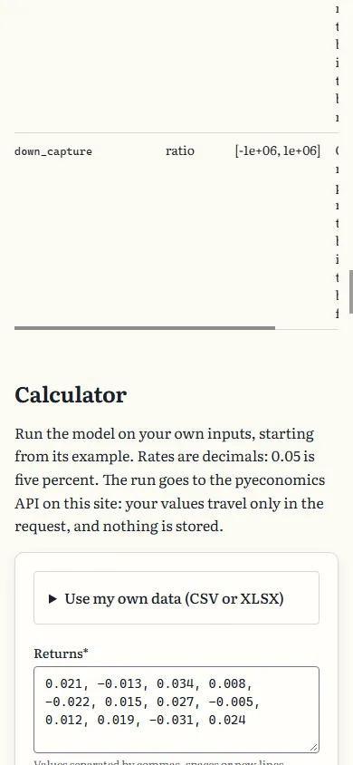
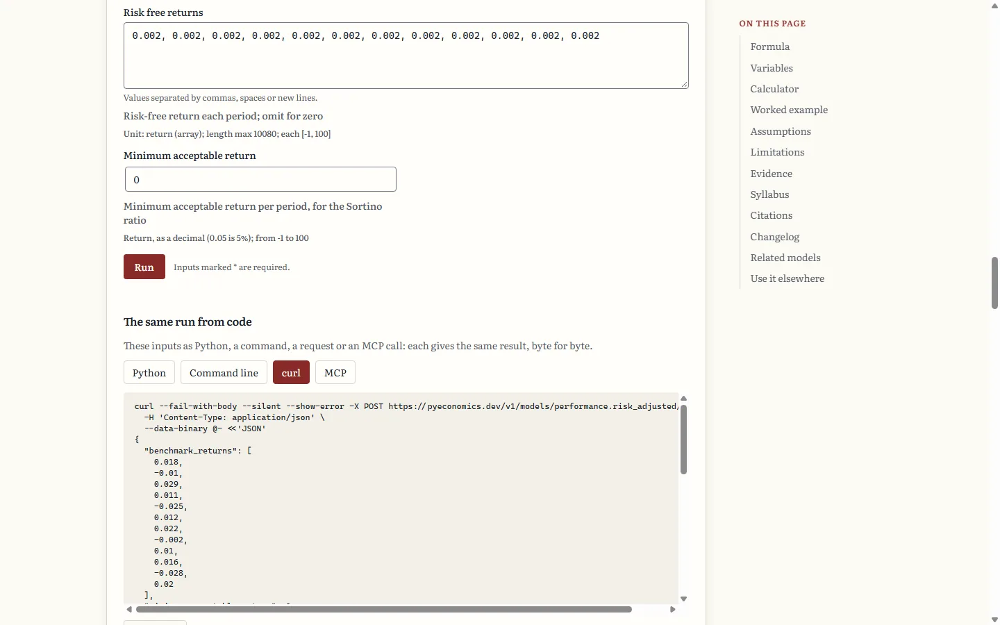
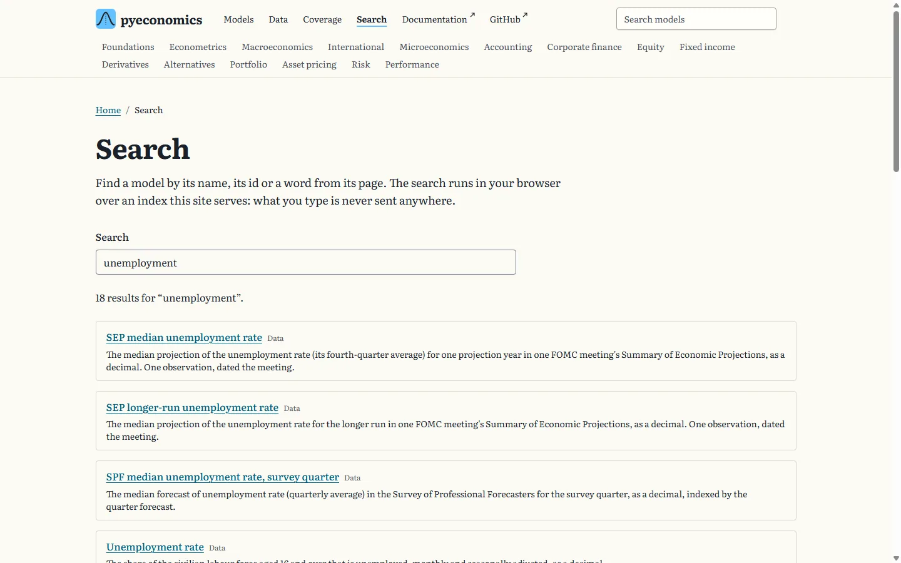
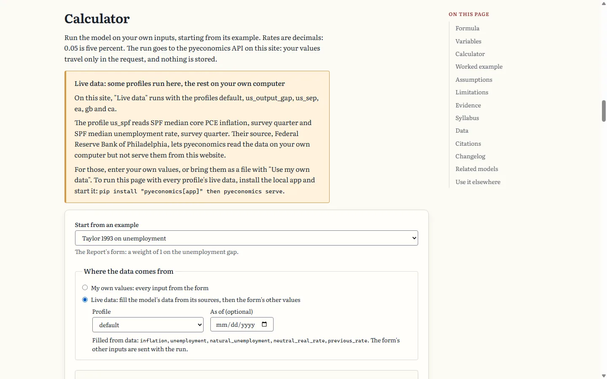
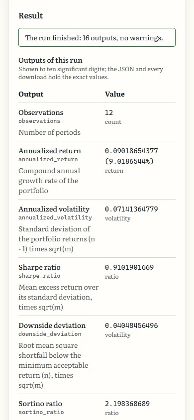
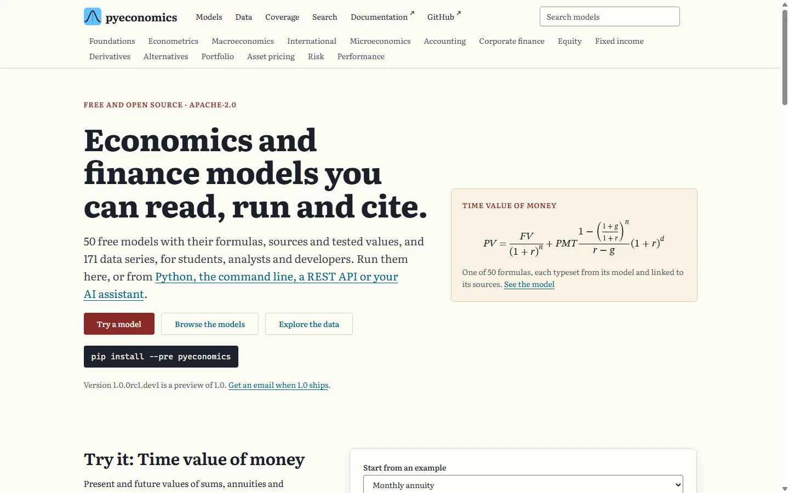

# Dogfooding round 2: after round 1's fixes

Round 2 of the protocol in [dogfooding.md](../dogfooding.md), run on 2026-11-16 in
Phase 5 Step 18. It looked at the site after [round 1](round-1.md)'s implementer
pass: the formulas' symbols defined, the calculator's form, result and code
reworked, the explorer's chart drawn on view, and round 0's open list closed.

- **Site:** the local production build of this step's branch at 0798fb6, with one
  fix on top that the harness's own first run of the round asked for (the new
  citation line's address could not wrap, and widened a concept's page by four
  pixels on a phone), served by `wrangler dev` with `tests/web/e2e_api.py`
  answering the API over the catalog world's stand-in data.
- **Harness:** `npm run dogfood`, run `round-2`: the same 108 page captures and 30
  task states. All 138 passed, with no sideways overflow, stray scroll box, console
  error or policy violation. No page capture shifted by more than 0.011 as it
  loaded (round 1: thirteen above 0.1, the worst 0.232). Two task states recorded
  0.176, which was the harness's own doing (L17 below).
- **Evaluators:** five fresh subagents on Claude Sonnet 5.5, one per persona, none
  of which had seen round 1 or anything of the implementation, each given the
  protocol's prompt word for word with the same working notes as round 1. Each did
  its tasks in Chromium through `tests/dogfood/visit.ts` (10 to 15 visits each, the
  after-scoring pass included) and read the contact sheets.
- **After scoring**, each was shown round 1's merged list and said which items it
  found fixed, still there or worse. That pass changed no score.

## Scores

| Dimension | P1 candidate | P2 developer | P3 student | P4 first visit | P5 phone | Median | Round 1 |
| --- | --- | --- | --- | --- | --- | --- | --- |
| D1 First impression and identity | 8 | 8 | 8 | 8 | 8 | **8** | 8 |
| D2 Hierarchy and layout | 8 | 7 | 7 | 7 | 7 | **7** | 7 |
| D3 Typography and formulas | 8 | 8 | 8 | 8 | 8 | **8** | 8 |
| D4 Colour, contrast and theming | 8 | 8 | 7 | 7 | 8 | **8** | 8 |
| D5 Interaction, feedback and motion | 7 | 7 | 7 | 7 | 7 | **7** | 7 |
| D6 Navigation and findability | 8 | 7 | 6 | 7 | 7 | **7** | 6 |
| D7 Content and microcopy | 7 | 8 | 6 | 6 | 7 | **7** | 6 |
| D8 Trust and polish | 8 | 8 | 8 | 7 | 8 | **8** | 7 |
| Mean | 7.75 | 7.63 | 7.13 | 7.13 | 7.50 | **7.50** | 7.00 |

The round's median, the median of the five means, is **7.50**, up **0.50** from
round 1's 7.00. Navigation, content and trust each rose by one; no dimension fell,
and no evaluator scored one below 6. Every persona's mean rose (by 0.25 to 0.75).

**The stopping rule does not stop the loop here.** The round found no Blocker and
no High issue, but the rule also asks that the median rise by less than 0.5, and it
rose by exactly 0.5. So the findings below were fixed and round 3 runs.

## Tasks

| Persona | Task 1 | Task 2 | Task 3 | Task 4 | Task 5 |
| --- | --- | --- | --- | --- | --- |
| P1 CFA® Program candidate | pass | hard: stayed on the duration page for a price, whose form takes dates | pass | pass | |
| P2 Python developer | pass | pass | pass | pass | |
| P3 economics student | hard: "Unemployment rate" came fourth in the search | pass | pass | pass | |
| P4 first-time visitor | pass | hard: who made it and whether it is tested are scattered | pass | pass | |
| P5 phone visitor | pass | hard: the variables table before the calculator runs off the screen | pass | pass | pass |

Of 21 tasks, 17 passed, 4 were hard and none failed. Round 1: 12, 9 and none.

## Findings

Merged across personas; the personas who found each are in brackets. "Fixed" means
fixed in this round's implementer pass, on this step's branch, with every gate
green; round 3's evaluators judge the fix.

### Blocker

None.

### High

None.

### Medium

| # | Finding | Destination |
| --- | --- | --- |
| M1 | A model's variables tables are four columns that run off a phone's screen: a field's description is read only by scrolling its table sideways, and from the left it shows as a strip one letter wide [P5] | Fixed: on a phone each table is two columns, the unit and bounds under the name, and four again from 640 pixels; each name is in words with its id beneath. A check measures three models' tables at 390 wide: none scrolls, and every description is in view |
| M2 | Who makes the site and whether it is tested have no page: "About this site" leads to the legal index, `/about/` is a 404, and "tested values" on the first screen links nothing (round 1's M8 and M9, which its fix only moved) [P4] | Fixed: `/about/`, which says what pyeconomics is, who runs the site (the legal index's own sentence, and nothing more about them), where the formulas come from, how each model is tested and where the data comes from, each with its numbers counted from the site data; the first screen's "tested values" links it, and the footer has "About" and "Legal" as two links |
| M3 | Nothing on the site says how to connect an AI assistant: no client configuration, no hosted endpoint, and a search for "MCP" finds legal pages (round 1's M15) [P2 P3] | Fixed: `/assistants/`, with the configuration a client reads, the hosted endpoint, the five tools (held equal to the server's by a test) and each model's own tool, and what data may reach an assistant; linked from the home page, each model's "Use it elsewhere", the calculator's MCP note and the footer, and searchable |
| M4 | After a run the code for the same run is below a long result, and nothing leads to it [P2] | Fixed: "These inputs as code" beside the Run button. Not added to "On this page": that list is the page's own sections, and the code is inside the calculator, which is not on the page until it loads |
| M5 | A snippet's box: twelve returns take twelve lines, the copy button is under the box and out of sight, and curl's first line runs off [P2] | Fixed: a long list fills lines a phone's code box shows whole, in Python and in JSON; the copy button is beside the choices, above the code; curl's address has a line of its own |
| M6 | A search for "unemployment" lists three forecast series above "Unemployment rate", and every result is tagged "Data" [P3] | Fixed: a page whose title begins with what was typed comes first, the shortest such title leading; a series is tagged "Data series" |
| M7 | The live-data notice and the profile picker list raw profile ids (`us_sep`, `ea`, `gb`) [P3] | Fixed: each profile by its name ("US FOMC projections", "Euro area"), its id beside a name that does not spell it, in the notice, the picker and the data tables |
| M8 | Choosing "Live data" does not say what will be read, or as of when [P3] | Fixed: the line under the picker names the inputs read from data in words, says "at its latest values" or the date set, and that the result lists each series with its source and the date of its last observation |
| M9 | Asked for a bond's price, a visitor on the duration page finds dates, not years, "money" as the unit, and no way on to the pricing model [P1] | Fixed in part: "Every Fixed income model" under the related models. Disputed, as in round 1: the inputs are dates so accrued interest is exact, and "money" is the models' own unit (they hold no currency) |
| M10 | A frequency chosen after other edits seemed lost: the price, 95.6705, "matches semiannual compounding" [P1] | Not a defect: 95.6705 is the annual-pay price (4 × (1 − 1.05⁻⁵) / 0.05 + 100 × 1.05⁻⁵), with the Macaulay duration of 4.62 the evaluator saw; semiannual coupons give 95.6240 and 4.57, checked by running the model both ways. The code beneath the form shows the inputs a run sends |
| M11 | A result of sixteen outputs is a long list on a phone, and the figure looked for is fourth [P5] | Disputed: the outputs come in the model card's order, the registry names no main output, and each row's description is what says what the number is |

### Low

| # | Finding | Destination |
| --- | --- | --- |
| L1 | A failed run's box is far below the Run button and may not come into view [P1] | Not reproduced: a failed run's heading is brought into view and focused exactly as a result's is, and the visit's own screenshot shows it |
| L2 | Five formulas share one plate with equal weight (noted again after scoring by three evaluators) [P1] | Disputed: a model's formulas are a list in its card, with no names or groups to lay out; the "Where" list under them defines every symbol |
| L3 | The variables section names calculations by id, leads with code names and pushes the calculator down [P1 P5] | Fixed in part: each calculation is named in words with its id, and each field in words with its id beneath. The order stays: "Run the calculator" is the first link under the title |
| L4 | The chart's axis reads "Percent" beside a unit note in decimals, and the source's notice appears twice [P3] | Fixed in part: the downloads' note says the chart shows percents and the files hold decimals. The notice is on the chart and beneath it by rule (a chart carries its attribution on itself) |
| L5 | /sources/ gives most local-only sources the same short reason [P3] | Fixed in part: each shows its licence class, linked to the table that says what the class allows |
| L6 | A concept's sources table says "library-only" and "Hosted" with nothing beside them [P3] | Fixed: plain words above the table, the column headed "On this site", a link to what each licence class means; the table fits a phone |
| L7 | "Loading the calculator…" is a line in a blank card [P4] | Fixed: the room held for the form shows faint bars where its fields will be |
| L8 | The preview line leads with a raw version, and `pip install --pre` assumes Python [P4] | Fixed in part: "This is a preview of version 1.0", the exact version after it. The install line stays: it is for those who install |
| L9 | The footer's links run in one line, and the header's domain row is small [P4] | Fixed for the footer: four groups under short headings. The header's row is disputed, as in round 1 |
| L10 | The privacy policy is long and uses legal terms [P4] | Disputed: its short version leads, and the rest is the policy |
| L11 | On a phone, search is a page of its own and its results are mixed [P5] | Disputed (round 0's L2): /search/ searches as a visitor types and tags each result's kind; M6 puts the page named for the query first |
| L12 | The phone menu's rows are tight, about 24 pixels [P5] | Not reproduced: each row is 44 pixels tall, measured |
| L13 | The home page weighs 716 KB [P5] | Disputed: the first screen draws in a third of a second with two font files; the rest is the calculator, which loads only when a visitor scrolls to it (the capture does) |
| L14 | "Use it elsewhere" repeats code in dark boxes, beside the calculator's light ones [P2] | Fixed: one look for a block of code everywhere, the calculator's snippets and the worked example's JSON included |
| L15 | The manifest is closed by default (round 1's M16, still there for P1) [P2 P1] | Fixed: the versions and the two hashes are in view under the outputs |
| L16 | On the home page the calculator comes before the code [P2] | Disputed: the first screen has the install line and a link to the code; trying it first is the direction's order |
| L17 | The harness recorded a layout shift of 0.176 on the duration page when a family's second example was chosen (read as round 1's L9 still there) [P1 P2] | The harness's fault, not the site's: a scripted choice was not counted as input, as a visitor's is (dogfooding.md's change log, 2026-11-16) |

### Found by the gates, not the evaluators

| # | Finding | Destination |
| --- | --- | --- |
| G1 | The round's own first harness run: the new citation line's address could not wrap, and widened a concept's page by four pixels on a phone | Fixed before the evaluators began; the phone-width check now waits for a page's islands to load their data |
| G2 | Lighthouse scored the bond-pricing page 86 for performance in two runs of three. A page of formulas takes about a tenth of a second to lay out; where the browser painted the header alone first, the page's main text was a later, separate paint, which Lighthouse's simulation timed at 3.5 seconds (0.9 where both came in one paint). The race is older than this step, and more formulas (the symbols' list) made it likelier | Fixed: a model page and the home page hold their first paint until the first screen is parsed (`<link rel="expect" blocking="render">`, which a browser that does not know it ignores), so header and text arrive together. All fifteen sample pages then scored 92 to 100, each run of every formula page with one paint; a built-site test holds the link and its target on every model page |
| G3 | The layout-shift check failed once on the home page (0.107 on a phone). The room each page holds for its calculator had drifted from the forms: the median error was 60 pixels on a phone and 92 on a wide card, the largest 514, because the code box is shorter now that lists are filled, and the home page's card, beside its introduction on a wide screen, is as narrow as a phone's | Fixed: the estimate was refitted to all 50 models at three widths, with terms for a matrix's rows and for descriptions that wrap, and the code section measured, not fitted (median error 30 and 21 pixels, the largest 130); the home page holds a phone's room for its card where the card is a phone's width |
| G4 | The same check failed once on the search page at a desktop's size (0.126): with the footer's links in four groups the footer is taller, and it moved when the results arrived on a page already scrolled to its foot | Fixed: the search page holds a full screen for its results, so the footer starts below the first screen at any size; the check lets a page finish what its address asks for before it scrolls, as a visitor reads the first screen first |
| G5 | axe read the explorer's "Draw the chart" button at a contrast of 2.6, in one run of six when six ran at once: a button that is off until its island loads faded back in over 150 milliseconds, and axe looked mid-fade | Fixed: no button's opacity transitions, so one is either off or fully drawn; a unit test fails on a disabled look beside a transition of every property |

## Round 1's list, checked after scoring

Each evaluator, after its scores were in, said for each item of round 1's list whether
it was fixed (F), still there (S) or worse (W); a dash is an item it had not looked at.

| Round 1 | P1 | P2 | P3 | P4 | P5 | Now |
| --- | --- | --- | --- | --- | --- | --- |
| H1 symbols never defined | F | F | F | – | F | Fixed in round 1 |
| H2 live-data notice contradicts a run | – | – | F | F | – | Fixed in round 1 |
| H3 result wider than a phone | F | F | F | F | F | Fixed in round 1 |
| M1 result far below, no sign it finished | F | F | F | F | F | Fixed in round 1 |
| M2 names read as code | F | F | F | F | F | Fixed in round 1 |
| M3 a dozen fields, conventions first | F | – | F | F | – | Fixed in round 1 |
| M4 cross-field error in API words | F | – | – | – | – | Fixed in round 1 |
| M5 chart not drawn until asked | F | F | F | F | – | Fixed in round 1 |
| M6 no way to cite a series | F | – | F | – | – | Fixed in round 1 |
| M7 /data/ in id order | F | F | F | F | – | Fixed in round 1 |
| M8 no page says who makes it | – | – | – | S | F | Fixed in this round (M2) |
| M9 "Cited" and "Tested" only claim | F | – | – | S | – | Fixed in this round (M2) |
| M10 1.0 notice only in the footer | F | F | F | F | F | Fixed in round 1 |
| M11 phone menu capture | F | F | F | F | F | Fixed in round 1 (the harness) |
| M12 home formula cut on a phone | F | – | F | – | F | Fixed in round 1 |
| M13 code in a closed disclosure | F | F | F | F | F | Fixed in round 1 |
| M14 two MCP tool names | F | F | – | – | F | Fixed in round 1 |
| M15 no on-site page on MCP | F | F | S | – | F | Fixed in this round (M3) |
| M16 no hash beside a result | S | F | – | – | – | Fixed in this round (L15) |
| M17 no plain definition before the formulas | S | – | – | F | S | Disputed, as in round 1: the summary under the title is the model card's own |
| L1 chart title and axis | F | F | F | – | – | Fixed in round 1 |
| L2 no one-line explanation | F | F | F | F | F | Disputed in round 1; every evaluator read the card's summary as that line |
| L3 header's two rows of domains | S | S | F | S | F | Disputed, as in round 1 |
| L4 /sources/ one long list | F | F | F | F | – | Fixed in round 1 |
| L5 "free" only above the headline | F | F | F | F | F | Fixed in round 1 |
| L6 a word runs into a link | F | – | F | F | F | Fixed in round 1 |
| L7 "On this page" has twelve entries | S | S | F | S | F | Disputed, as in round 1 |
| L8 a select cuts its text | – | – | – | – | – | Fixed in round 1; its check holds |
| L9 pages shift as they load | S | S | F | – | F | Fixed in round 1; the two "still there" are L17 above |
| L10 "Explore the data" a bare link | F | F | F | F | F | Fixed in round 1 |
| L11 related models | F | S | – | – | – | Fixed in part in round 1; a card names another domain's model as such, by design |
| L12 a long list in the Python sample | – | F | – | – | – | Fixed in round 1, and again in this round (M5) |
| L13 the documentation's logo | – | – | – | – | – | Not reproduced in round 1; the documentation cannot be reached from the local build |

No item was judged worse.

## Cost

- **Harness:** 4.1 minutes for the 138 captures.
- **Evaluators:** 12 minutes from start to the last answer, the after-scoring pass
  included; 851,929 tokens in all (P1 179,914, P2 178,380, P3 168,770, P4 171,063, P5
  153,802), as the platform reported each subagent's use after its second pass.
- **Implementer pass:** the fixes above and their checks, 2 hours 23 minutes, of
  which about an hour went to what the gates found (G2 to G5), with every gate
  run on the final build before it closed (768 unit, 366 built-site and 511
  end-to-end tests, the local app's 4, web parity's 92, the Python test of the
  site's MCP tools, and Lighthouse on the fifteen sample pages: 97 to 100 for
  performance, 100 for accessibility). [summary.md](summary.md) gives the
  implementer's tokens for the whole loop.

## Screenshots

| | |
| --- | --- |
|  |  |
| A variables table on a phone: the description is a strip at the right edge (M1) | A snippet: a value to a line, the copy button below the box (M5) |
|  |  |
| "unemployment": three forecast series first (M6) | Live data: profiles by id, fields by id (M7, M8) |
|  |  |
| A result on a phone, as round 1 left it: two columns, the unit under its value | The home page's first screen, as round 2 saw it |
