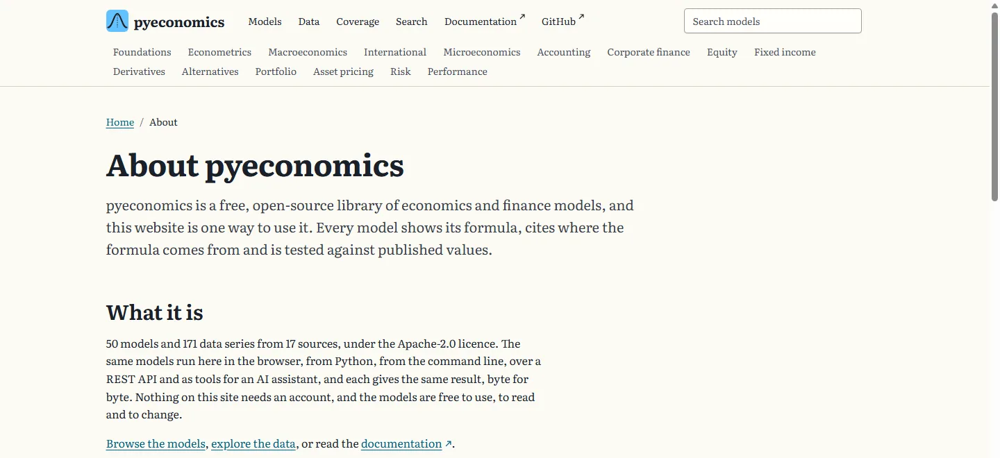
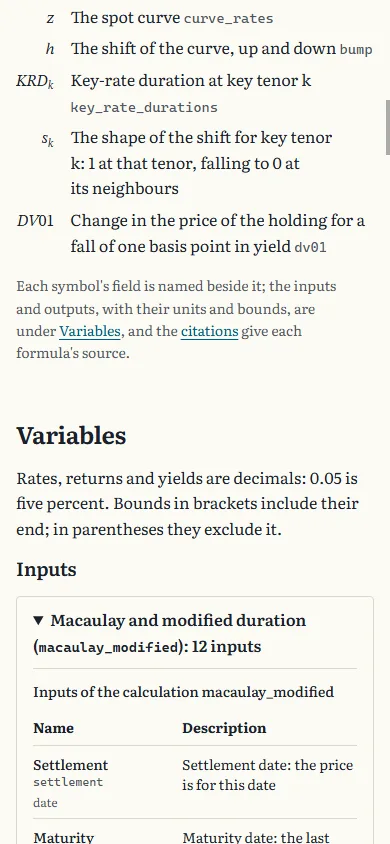
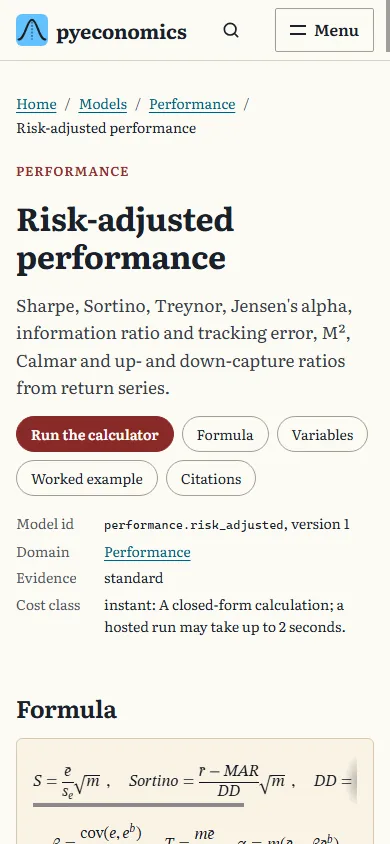
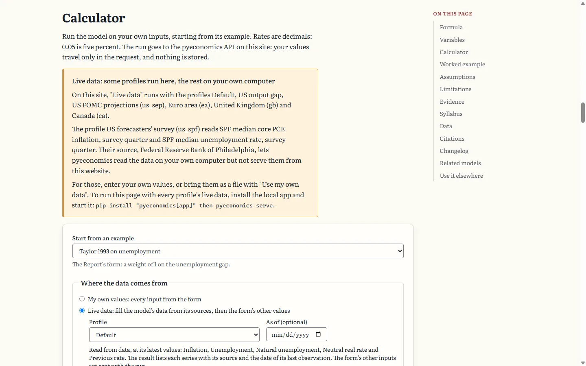
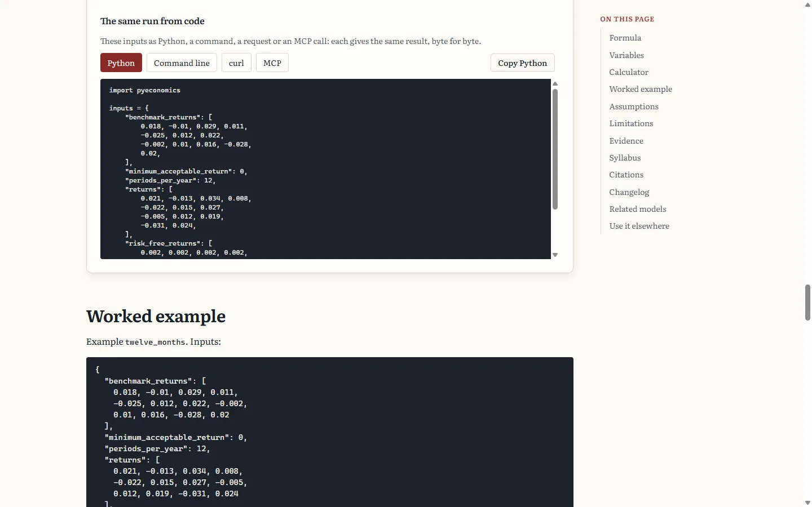
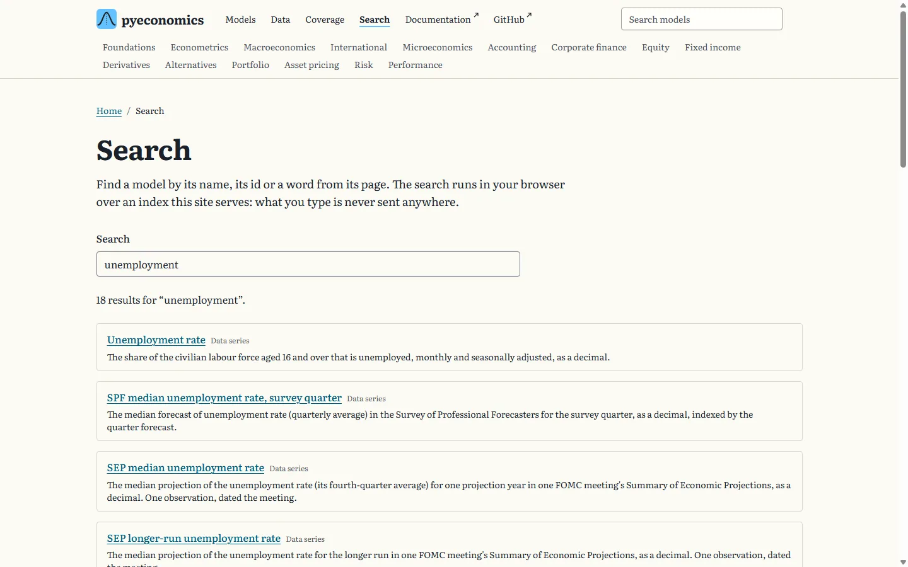

# Dogfooding round 3: the round the loop stopped at

Round 3 of the protocol in [dogfooding.md](../dogfooding.md), run on 2026-11-16 in
Phase 5 Step 18. It looked at the site after [round 2](round-2.md)'s implementer
pass: the variables tables on a phone, `/about/` and `/assistants/`, the snippets,
the search order, the profiles' names and what the gates found.

- **Site:** the local production build of this step's branch at d809f8d, served by
  `wrangler dev` with `tests/web/e2e_api.py` answering the API over the catalog
  world's stand-in data.
- **Harness:** `npm run dogfood`, run `round-3`: 108 page captures and 30 task
  states. All 138 passed, with no sideways overflow, stray scroll box, console error
  or policy violation, and no capture or task state shifted by more than 0.011 as it
  loaded.
- **Evaluators:** five fresh subagents on Claude Sonnet 5.5, one per persona, none
  of which had seen an earlier round or anything of the implementation, each given
  the protocol's prompt word for word with the same working notes as rounds 1 and
  2. Each did its tasks in Chromium through `tests/dogfood/visit.ts` (8 to 13
  visits each, the after-scoring pass included) and read the contact sheets.
- **After scoring**, each was shown round 2's merged list and said which items it
  found fixed, still there or worse. That pass changed no score.

## Scores

| Dimension | P1 candidate | P2 developer | P3 student | P4 first visit | P5 phone | Median | Round 2 |
| --- | --- | --- | --- | --- | --- | --- | --- |
| D1 First impression and identity | 8 | 8 | 8 | 8 | 8 | **8** | 8 |
| D2 Hierarchy and layout | 8 | 7 | 7 | 7 | 7 | **7** | 7 |
| D3 Typography and formulas | 8 | 8 | 8 | 8 | 7 | **8** | 8 |
| D4 Colour, contrast and theming | 7 | 7 | 7 | 7 | 8 | **7** | 8 |
| D5 Interaction, feedback and motion | 7 | 7 | 7 | 7 | 7 | **7** | 7 |
| D6 Navigation and findability | 7 | 7 | 5 | 8 | 7 | **7** | 7 |
| D7 Content and microcopy | 6 | 7 | 6 | 7 | 6 | **6** | 7 |
| D8 Trust and polish | 8 | 8 | 8 | 7 | 8 | **8** | 8 |
| Mean | 7.38 | 7.38 | 7.00 | 7.38 | 7.25 | **7.38** | 7.50 |

The round's median, the median of the five means, is **7.38**, against round 2's
7.50: a change of **−0.13**, inside what five new evaluators differ by from one
round to the next (each round's are fresh, so a round's median is one draw). No
evaluator scored a dimension below 5, and one score in forty was below 6.

**The stopping rule stops the loop here.** The round found no Blocker and no High
issue, and its median is less than 0.5 above round 2's. Another round would cost
what this one did and, on the evidence of two rounds within a quarter of a point of
each other, buy no more than this one's findings did: those below, which were fixed
or filed before the result was locked in.

## Tasks

| Persona | Task 1 | Task 2 | Task 3 | Task 4 | Task 5 |
| --- | --- | --- | --- | --- | --- |
| P1 CFA® Program candidate | pass | hard: the pricing model takes dates, not a term in years | pass | pass | |
| P2 Python developer | pass | pass | pass | pass | |
| P3 economics student | hard: the home page names no series; found by search | pass | hard: the calculator is far down a long model page | pass | |
| P4 first-time visitor | pass | pass | pass | pass | |
| P5 phone visitor | pass | pass | pass | pass | hard: a long formula is swiped sideways in its box |

Of 21 tasks, 17 passed, 4 were hard and none failed, as in round 2. The first-time
visitor's four all passed for the first time: "who made it, and is it tested" was
hard in every round before `/about/`.

## Findings

Merged across personas; the personas who found each are in brackets. "Fixed" means
fixed in this round's implementer pass, on this step's branch, with every gate
green. No round follows to judge these fixes locally: the confirmation round on
staging, after the merge, does.

### Blocker

None.

### High

None.

### Medium

| # | Finding | Destination |
| --- | --- | --- |
| M1 | The bond calculators take a settlement and a maturity date, not a term in years, and their first example is a thirty-year Treasury (rounds 1 and 2 disputed it as the model's own) [P1] | Issue #351: an example a textbook would give, first in each bond model's `examples`, and a word on turning a term into dates. The page writes no example or field for one model |
| M2 | A price's unit is "money", with no word that it is per 100 of face value; Frequency, semiannual by default, sits among the conventions [P1] | Issue #351 for the outputs' descriptions. The form's order stays: a field with a default is neither hidden nor moved, because its value changes the result |
| M3 | On a phone a long formula is wider than the screen and is read by swiping it sideways in its box [P5] | Issue #350, with the formulas' other typography: where a formula breaks is its author's choice, and MathML has no automatic line breaking. The box scrolls with a fade and a bar at its edge, by the design's rule for wide content |
| M4 | A result of sixteen outputs is a long, dense list: an id and a sentence under every name, ten digits a value (round 2's M11, still there for both) [P4 P5] | Fixed: a result of more than eight outputs lists each by name, id, value and unit, with a box to tick for what each is; a shorter result shows its descriptions as before. Ten significant digits stay, under a line that says the files hold the exact values. Not done: "headline outputs first" (the registry names no main output) |
| M5 | A snippet's box is 320 pixels tall, so the call that runs the model is below the fold of the box [P2] | Fixed: the box grows to 480 pixels, which shows a typical snippet whole; the room held for it follows |
| M6 | A developer who lands on a model's page finds no install line beside its snippets [P2] | Fixed: the Python and command-line snippets say "Install the package first" with the command. (The evaluator thought the code appears only after a run: it is beneath the form from the start, as since round 1.) |
| M7 | After a run the manifest, the downloads and the code are far below a long result, and "On this page" has no entry for them (round 2's M4, still there) [P2] | Fixed in part: M4 halves a long result, and round 2's "These inputs as code" beside Run leads to the code. "On this page" is disputed as in round 2 |
| M8 | The home page names no data series, and the header's box says "Search models" [P3] | Fixed: the home page's Data card names what the series are ("from unemployment and inflation to interest rates and yield curves"), the box reads "Search models and data", and the search page says it finds series |
| M9 | On the policy-rule page the calculator comes after the formulas and long variables tables [P3] | Disputed: "Run the calculator" is the first link under every model's title at every size, and the page's order (formula, variables, calculator) is the direction's |
| M10 | The live-data notice is long, shows ids in brackets, and nothing says the default profile reads US data; the radio's label is long (round 2's M7, still there) [P3] | Fixed in part: a profile whose name says nothing of where its data is from says so, "Default (United States data)", in the notice and the picker, read from its series' ids; the radio reads "Live data: read the model's data from its sources". An id stays beside a name that does not spell it, because it is what the API takes, and the notice keeps the command that runs what the site may not serve |
| M11 | A series' unit is a decimal and its chart's axis a percent, explained only under the downloads; a transform reads "Earlier value (lag) (lag)" [P3] | Fixed: the sentence is under the chart, and no transform's label repeats its name |
| M12 | Credibility is one click from the first screen, not on it: no author, no test counts [P4] | Disputed: the first screen says what the site is and links "tested values" to the page with the numbers and who runs it, and the evaluator's task passed. A strip would be a fifth line on a first screen the same evaluator calls crowded, and the maintainer's name goes on the home page only with their word |
| M13 | An error under a field is smaller than the text around it, and there is no summary by the Run button [P1] | Fixed in part: a field's error is set at the form's text size. The line under Run that says how many inputs need fixing, and which, was there |

### Low

| # | Finding | Destination |
| --- | --- | --- |
| L1 | The preview line's version reads "devl": in the text face a one looks like an l (round 2's L8) [P4] | Fixed: the version is set in the code face |
| L2 | "Loading the calculator…" above an empty box (round 2's L7) [P4 P2] | Not reproduced as described: the room shows bars where the form's fields will be since round 2; the captures show the card's first lines only |
| L3 | The first screen's sentence holds several links [P4] | Fixed: two, as before round 2 |
| L4 | The header's two rows of navigation [P4] | Disputed, as in rounds 1 and 2 |
| L5 | A list field's help reads "Unit: return (array); length min 2, max 10080; each [-1, 100]" [P5] | Fixed: "A list of returns, as decimals (0.05 is 5%); 2 to 10,080 values; each from -1 to 100" |
| L6 | In the "Where" list a field's name is as heavy as its meaning, and some symbols are small on a phone [P1 P5] | Fixed in part: a field's name is smaller and muted. A symbol is set as its formula sets it |
| L7 | The phone menu's rows are "24 pixels apart" (round 2's L12) [P5] | Not reproduced: each row is 44 pixels tall, measured in round 2 |
| L8 | Search lists a domain's page above some models, and its labels are small [P5] | Disputed: after the page named for the query, the order is the index's own |
| L9 | Five formulas share one plate (noted after scoring by four evaluators) [P1] | Disputed, as in round 2 |
| L10 | A guessed address answers a 404 page that only offers the home page [P1] | Fixed: the 404 page offers the search, the models and the data |
| L11 | Fields with defaults (day count, first period) sit among the inputs a run needs [P1] | Disputed: a field with a default is never hidden, because its value changes the result |
| L12 | The line under the form said "6 outputs" where the result said 5 [P3] | Fixed: one count (a family's calculation is not an output), with a check |
| L13 | The values the live data supplied are not shown beside the outputs [P3] | Disputed: "Sources" under the outputs lists each series with its dates, and the result's JSON holds every input it ran on |
| L14 | A source's notice is on the chart and under it; the date fields are the browser's own [P3] | By rule (a chart carries its attribution on itself), and by the browser |
| L15 | /sources/ opens on two dense paragraphs, and its cards are one column on a phone [P3] | Disputed: its first sentence gives the counts, and a source's name does not fit half a phone's width |
| L16 | "originator", "aggregator" and the licence classes have no gloss where they appear [P3] | Fixed in part: a concept's sources paragraph says what an originator and an aggregator are, beside the link to what each licence class means |
| L17 | A model without a tool of its own should name the tool to call [P2] | Already so: "run_model with the model's id" and the id, under "Use it elsewhere" |
| L18 | Nothing says how to read a result's hash from Python [P2] | Fixed: the manifest names `result.manifest.result_sha256` |
| L19 | The install block does not say why `--pre` [P2] | Disputed: the line beneath it says this is a preview of 1.0 |

## Round 2's list, checked after scoring

Each evaluator, after its scores were in, said for each item of round 2's list whether
it was fixed (F), still there (S) or worse (W); a dash is an item it had not looked at.

| Round 2 | P1 | P2 | P3 | P4 | P5 | Now |
| --- | --- | --- | --- | --- | --- | --- |
| M1 variables tables off a phone's screen | F | – | – | F | F | Fixed in round 2 |
| M2 no page says who makes it | F | – | F | F | F | Fixed in round 2 |
| M3 no word on connecting an assistant | F | F | F | – | F | Fixed in round 2 |
| M4 code far below a long result | – | S | – | – | – | Fixed in part in this round (M4, M7) |
| M5 a snippet's lines, copy button and curl | – | F | – | – | – | Fixed in round 2; the box's height in this round (M5) |
| M6 search order for "unemployment" | S | – | F | – | F | Fixed in round 2: the rate is first for all three; P1's "still there" is the forecast series after it |
| M7 raw profile ids | – | – | S | – | – | Fixed in part in this round (M10): names lead, an id stays beside one |
| M8 "Live data" does not say what it reads | – | – | F | – | – | Fixed in round 2 |
| M9 dates, not years; "money" | S | – | – | – | – | Issue #351 |
| M10 a frequency seemed lost | F | – | – | – | – | Not a defect (round 2) |
| M11 sixteen outputs, a long list | – | – | – | S | S | Fixed in this round (M4) |
| L1 a failed run's box out of view | S | – | – | – | – | Not reproduced (round 2); a field's error is larger now (M13) |
| L2 five formulas in one plate | S | S | S | – | S | Disputed |
| L3 variables name calculations by id | F | – | S | – | F | Fixed in part in round 2; the order is disputed (M9) |
| L4 percent axis beside a decimal unit | – | – | S | – | – | Fixed in this round (M11) |
| L5 /sources/ reasons alike | – | – | – | – | – | Fixed in part in round 2 |
| L6 "library-only" and "Hosted" unexplained | – | – | F | – | – | Fixed in round 2 |
| L7 "Loading the calculator…" in a blank card | – | S | – | S | – | Fixed in round 2 (L2 above) |
| L8 the preview line's raw version | S | S | S | S | S | Fixed in this round (L1): it read "devl" |
| L9 the footer's links in one line | – | F | F | F | F | Fixed in round 2 |
| L10 the privacy policy's length | – | – | – | – | – | Disputed |
| L11 search a page of its own on a phone | – | – | – | S | S | Disputed |
| L12 the phone menu's rows | – | – | – | – | S | Not reproduced |
| L13 the home page's weight | S | S | S | S | S | Disputed: the capture scrolls to the calculator, which is most of it |
| L14 code boxes of two looks | – | F | – | S | – | Fixed in round 2: every block is the dark one; P4's "still there" is that it is dark |
| L15 the manifest closed | F | F | – | F | – | Fixed in round 2 |
| L16 the calculator before the code | – | F | – | S | – | Disputed |
| L17 a layout shift on a scripted choice | F | – | – | F | F | Fixed in round 2 (the harness) |

No item was judged worse.

## Cost

- **Harness:** 4.2 minutes for the 138 captures.
- **Evaluators:** 12 minutes from start to the last answer, the after-scoring pass
  included; 656,861 tokens in all (P1 126,277, P2 150,365, P3 140,978, P4 120,394, P5
  118,847), as the platform reported each subagent's use after its second pass.
- **Implementer pass:** the fixes above and their checks, 29 minutes, with every
  gate run on the final build before it closed (769 unit, 366 built-site and 511
  end-to-end tests, the local app's 4, web parity's 92, and Lighthouse on the
  fifteen sample pages: 97 to 100 for performance, 100 for accessibility).
  [summary.md](summary.md) gives the implementer's tokens for the whole loop.

## Screenshots

| | |
| --- | --- |
|  |  |
| `/about/`, new in round 2: what it is, then who runs it and how it is tested | A variables table on a phone: two columns, every description in view |
|  |  |
| A long formula on a phone: swiped sideways in its box (M3) | Live data: profiles by name, with what will be read (M10) |
|  |  |
| A snippet: lists filled, the copy button above, the call below the box's fold (M5) | "unemployment": the rate first (round 2's M6) |
