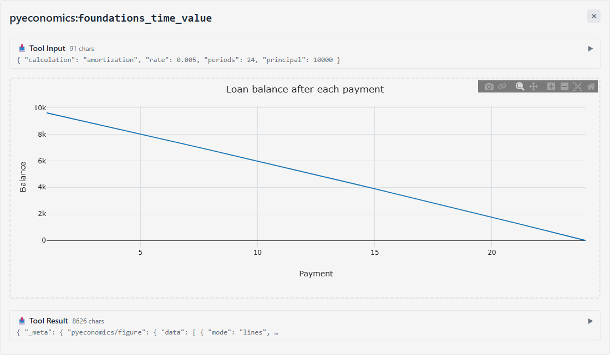

# The MCP server

`pyeconomics mcp` serves every registered model and every data source to an AI
assistant through the [Model Context Protocol](https://modelcontextprotocol.io)
(MCP). An assistant finds a model, reads its inputs and runs it with a handful
of tools, not one per model, and every run answers exactly the bytes of the
Python API's `Result.to_json()`, with the manifest of every source it read.
Data whose terms do not let it reach a language model never reaches yours.

The server follows the MCP specification of 2026-07-28, statelessly, and
serves clients of its earlier revisions (2024-11-05 to 2025-11-25) as well,
over stdio or Streamable HTTP.

## Install and run

The server is in the `mcp` extra, the official MCP SDK. The quickest way to run
it is `uvx`, which installs it into a cached environment of its own:

```shell
uvx --prerelease allow --from "pyeconomics[mcp]" pyeconomics mcp
```

`--prerelease allow` is needed while 1.0 is in pre-release; without `uvx`,
install the extra and run the command:

```shell
pip install --pre "pyeconomics[mcp]"
pyeconomics mcp
```

The command speaks MCP over standard input and output, which is how desktop
clients launch a server: you do not run it yourself, your client does. Without
the extra it exits with code 8, naming it.

### Claude Code

Add the server to Claude Code with `claude mcp add`; everything after `--` is
the command Claude Code runs:

```shell
claude mcp add pyeconomics -- uvx --prerelease allow --from "pyeconomics[mcp]" pyeconomics mcp
```

`--scope user` makes it available in every project, rather than the current one.

### A client configuration file

Clients that read a JSON configuration file (Claude Desktop's
`claude_desktop_config.json`, and others in the same shape) take the same
command:

```json
{
  "mcpServers": {
    "pyeconomics": {
      "command": "uvx",
      "args": ["--prerelease", "allow", "--from", "pyeconomics[mcp]", "pyeconomics", "mcp"]
    }
  }
}
```

The server reads your keys and settings as the library does ({doc}`data/keys`):
from the OS keyring, the environment or your `.env` file. A client starts it
with the environment the client passes, so a key in your shell's environment may
not reach it; the keyring always does.

### Over HTTP

`pyeconomics mcp --transport http` serves the same server as Streamable HTTP at
`http://127.0.0.1:8765/mcp` instead, for a client that connects to a URL:

```shell
pyeconomics mcp --transport http --port 8765
claude mcp add --transport http pyeconomics http://127.0.0.1:8765/mcp
```

It takes `--host` (default `127.0.0.1`), `--port` (default `8765`) and
`--allow-remote`, under the same guard as `pyeconomics serve`: a host that is not
a loopback address is refused unless `--allow-remote` is passed, because every
source your machine can access, with your keys, would be served to whoever can
reach it. The REST server ({doc}`api`) also serves the MCP server at `/mcp`,
beside `/v1`, when the `mcp` extra is installed.

## The tools

Five tools reach every model and every source:

| Tool | What it does |
|------|--------------|
| `search_models` | Searches the models by words in their ids, titles, tags, domains and summaries (`query`, with `limit` and `domain`), or lists a domain's models; each entry gives the id, title, summary, domain, cost class and whether the model can bind its inputs to data |
| `describe_model` | A model's specification, its input and output JSON Schemas (every number with its unit; rates are decimals) and its model card, by `model_id` |
| `run_model` | Runs any model on its `inputs`; with `as_of`, `vintage`, `profile`, `concepts` or `parameters` it first binds the model's inputs to the data catalog, as `pyeconomics.bind` does (`profile: "default"` binds the latest data) |
| `get_series` | A catalog concept's data, or a provider series' (`provider:series`), with its source records and the attributions it must be shown with: `start`, `end`, `as_of`, `vintage` and `provider`, as `pyeconomics data get` takes them |
| `list_sources` | Every data provider with its licence class, its `llm_use` class, whether this server's policy lets its data reach your assistant, its attribution and its terms page, and whether a key is configured (never the key) |

Sixteen widely used models also have a tool of their own, named
`<domain>_<name>` from the model's id, whose inputs are the model's own: an
assistant can call them without describing the model first.

| Tool | Model |
|------|-------|
| `corporate_capital_budgeting` | NPV, IRR, MIRR, payback, profitability index |
| `corporate_cost_of_capital` | CAPM, WACC, unlevered and relevered beta |
| `derivatives_binomial_tree` | Binomial option prices and Greeks |
| `derivatives_black_scholes_merton` | Black-Scholes-Merton prices, Greeks and implied volatility |
| `equity_dividend_discount` | Gordon, two-stage and H-model values |
| `equity_free_cash_flow` | FCFF, FCFE and DCF values |
| `fixed_income_bond_pricing` | Bond price, accrued interest and yields |
| `fixed_income_curve_bootstrap` | Spot, par and forward curves |
| `fixed_income_duration` | Macaulay, modified, effective and key-rate duration, DV01 |
| `foundations_returns` | Holding-period, arithmetic, geometric and real returns |
| `foundations_time_value` | Present and future values, annuities, NPV, IRR |
| `international_parity_conditions` | Interest and purchasing power parity |
| `macro_policy_rule` | Taylor and other monetary-policy rules |
| `performance_risk_adjusted` | Sharpe, Sortino, Treynor and information ratios |
| `portfolio_mean_variance` | Frontier, minimum-variance and tangency portfolios |
| `risk_value_at_risk` | Value-at-risk and expected shortfall |

The tools are listed in that order every time, sorted by name, and every tool
declares an output schema.

### What a tool returns

A run (`run_model` or a model's own tool) answers three things: the result as
structured content, which a client checks against the tool's output schema; the
same result's canonical JSON as text, byte for byte what `Result.to_json()`
gives; and a one-line summary of it, such as:

```text
Bond duration (fixed_income.duration, version 2): calculation = macaulay_modified, full_price = 100, macaulay_duration = 8.161447949150189, modified_duration = 7.98185618498796.
```

A failure answers a tool error whose text is its problem from the same table the
command line and the REST API use ({doc}`problems`): invalid inputs name the
fields that failed, never their values, so the assistant can correct them.

### Charts in clients that support MCP Apps

A model that declares a chart (the amortization schedule of
`foundations.time_value`, the fan chart of `macro.policy_rule`'s forecast path)
draws it inside a client that supports the
[MCP Apps](https://modelcontextprotocol.io/docs/extensions/apps) extension, when
the server has the `plot` extra (`pip install --pre "pyeconomics[mcp,plot]"`):



Every run tool names the page `ui://pyeconomics/chart` in its
`_meta.ui.resourceUri`, and a run with a chart carries its Plotly figure in the
result's `_meta`, under `pyeconomics/figure`. The page draws that figure with
Plotly.js, the one script it loads, pinned by version and Subresource Integrity
from the one origin its content security policy names (`cdn.jsdelivr.net`); it
opens no connection and renders the figure's data, never markup. A client
without the extension ignores both, and the answer it gets is the same: the
structured content and the text never change with the chart.

## The MCP Registry

The server is listed in the official [MCP Registry](https://registry.modelcontextprotocol.io)
as `io.github.pyeconomics-dev/pyeconomics`, from 1.0.0b1, with the same
`uvx` command as above. The registry's entry is the repository's `server.json`:

```json
{
  "registryType": "pypi",
  "identifier": "pyeconomics",
  "runtimeHint": "uvx",
  "runtimeArguments": [{"type": "named", "name": "--from", "value": "pyeconomics[mcp]==<version>"}],
  "packageArguments": [{"type": "positional", "value": "mcp"}],
  "transport": {"type": "stdio"}
}
```

A release publishes it through `.github/workflows/mcp-registry.yml`, once PyPI
shows the version: the registry checks that the package's description (the
README) names the server with a hidden `mcp-name:` line.

## How the tools are evaluated

The tools' names, descriptions and schemas are tested with a real agent: it
answers a set of questions through this server alone, and each answer is
checked against the Python API's. {doc}`mcp-evaluations` records the latest run.

## Data and language models: the `llm_use` gate

Every source declares whether its terms let its data reach a language model:
`allowed`, `forbidden` or `unclear` (`pyeconomics data sources --format json`
lists them, and so does `list_sources`). The MCP server passes your assistant only what is
allowed:

- a **forbidden** source (FRED and ALFRED among them) is passed over when a
  concept is resolved, and the next source of the same data is used; a provider
  series from it is refused; when no source is left, the tool answers the
  `llm-use-forbidden` problem;
- an **unclear** source is passed over the same way unless you opt in;
- a source passed over for its vintages leaves data that is revised, which the
  result labels `revised_data`, as it does whenever no source keeps vintages;
- before any answer leaves the server, every record it carries is checked
  again, and an answer that still holds a refused record is withheld whole.

The opt-in to unclear data is yours alone. Set it in `pyeconomics.toml`:

```toml
allow_unclear_llm_use = true
```

or in the environment, as `PYECONOMICS_ALLOW_UNCLEAR_LLM_USE=1`. The server
reads it once, when it starts: no tool argument can set it, so an assistant
cannot opt itself in, and nothing makes forbidden data reach it.

## Local and hosted

`pyeconomics mcp` and `pyeconomics serve` run in **local mode**: every source
you can access, with your keys, and no time budget. The hosted service (from
Phase 5) serves the same tools at its own `/mcp` in **hosted mode**, behind the
same edge check and rate limits as its REST API:

- only sources whose licence allows a hosted service are read, as for `/v1`;
- a run is held to its model's time budget, in the same worker pool as `/v1`;
- a result larger than the server's limit (256 KiB by default) answers a notice
  instead of the data: its summary, its size and hash, and the path of the REST
  API's `GET` run that answers the whole result;
- `list_sources` says nothing about keys.

## What the tools never do

No tool executes code, fetches a URL you name, reads or writes a file, reads,
stores or returns a key, or changes the cache. A model or a series is named by
an id that the registry or the catalog validates, and the data layer fetches
only from each provider's declared hosts, under its own licence, cache and
offline rules. Results are the canonical JSON and a summary from a fixed
template: nothing a source returns is passed to your assistant as an
instruction.
